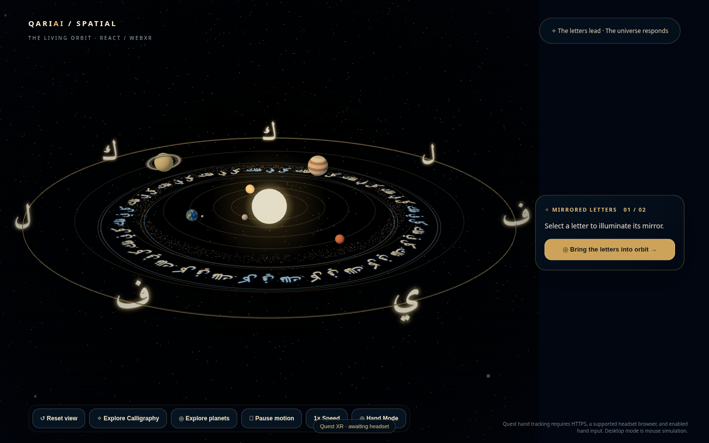
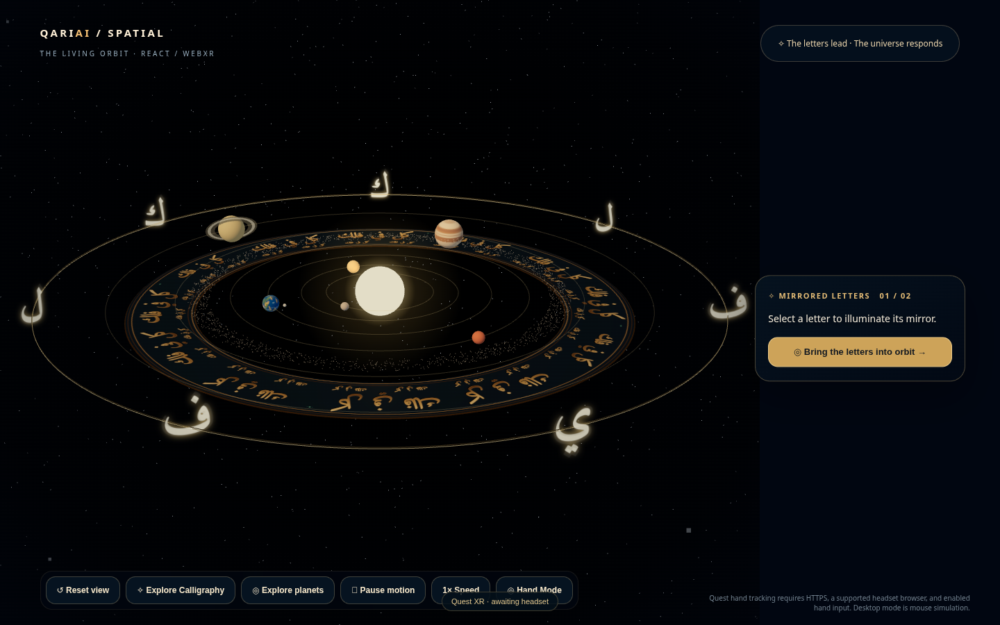
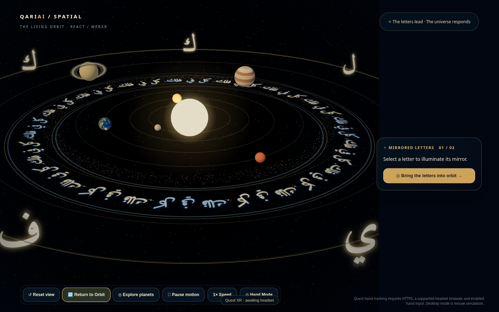
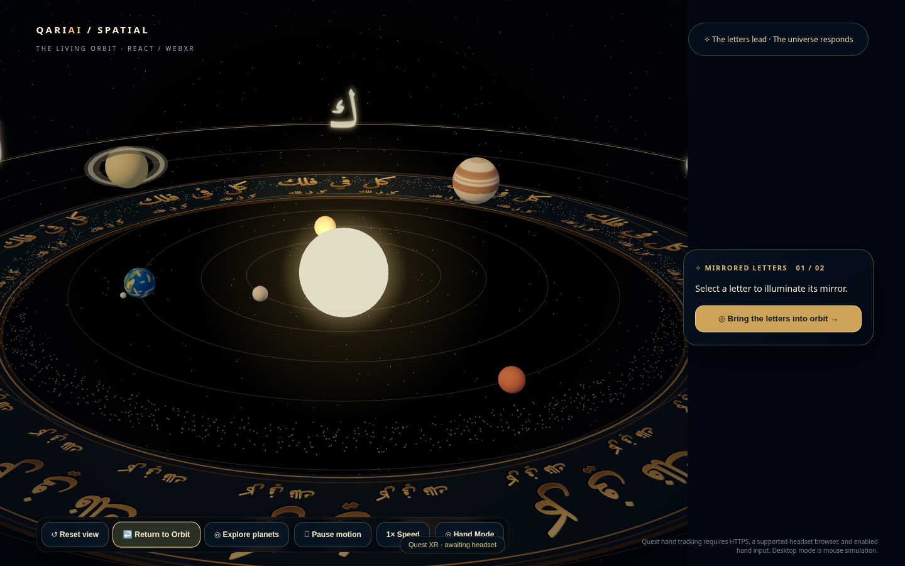

# v1.4.5 single-ring engineering prototype

This is the single-ring review checkpoint requested in issue #8. It does not claim to reproduce Gemini's complete multi-band screenshot. Approve the engraved treatment before expanding to nested bands. The giant floating verse and inset zoom window are omitted.

## Rendering and resources

A shaped Amiri excerpt, `كل في فلك`, is measured as a complete right-to-left phrase. It is the unvocalized excerpt from Qur'an 21:33, not the complete verse. The font is bundled with its OFL license; artwork is created after font readiness. Human Arabic review of circular orientation and legibility remains required.

The art uses two annulus meshes below the planets and main letters: an opaque slate face and a bronze backing. The main cartouches follow a three-part size and spacing rhythm with a smaller marginal script row. The face has deterministic fine grain, gold highlight/shadow lettering, a real grayscale bump map and separate turquoise ornamental clusters. Textures use mipmaps, device-capped anisotropy and explicit disposal. R3F owns the geometries/materials. There are no art particles, texture updates per frame or decorative raycast targets.

This is shallow normal-based engraving plus a stepped backing, not sculpted glyph geometry. Two 2048-square RGBA textures with mipmaps occupy approximately 43 MiB of GPU texture memory. There are two art draw calls per view and no transparent art overdraw. Actual Quest frame time, texture budgets, bump appearance and stereo readability require headset testing. Existing reduced XR stars/belt and framebuffer scale are retained.

## Camera and motion audit

Return formerly increased OrbitControls' minimum distance immediately, which could clamp the camera during a transition. Both modes now keep the same minimum. Transitions update both camera and the control target; the target includes the desktop WorldAnchor translation. An OrbitControls start event cancels the transition. The rig remains idle during ordinary exploration and cancels movement during XR.

The former proximity fade measured distance to the center of the entire artwork, not the closest surface. It also allocated vectors per frame. The new static micro-script relies on screen-space size and mipmapping to become readable nearby; it needs no center-distance threshold and naturally follows the existing XR root transform (0.014 scene-unit-to-meter scale). Existing world-space hand hit testing is preserved.

The seven letters previously ignored speed/pause. They now share those settings with the planets. Exactly seven initial letters, mirrored selection, two phases, planetary motion, Sun, Moon, Saturn rings, right-side panel, tracing, shortcuts and Quest architecture remain in place.

## Validation

- `npm run build`: TypeScript and Vite pass. The existing large-chunk warning remains.
- Chromium software rendering: inspected normal and close screenshots; local Amiri font readiness confirmed.
- Desktop interaction checks: mirrored pair highlighting, tracing/drawing/Escape, two phases, pause/resume for letters and planets, speed button, planet navigation passed.
- Camera handoff/Explore/Return/reset: passed after correcting the Canvas-owned camera reset. Initial fixed-delay assertions were replaced with waits on scene state; OrbitControls damping was allowed to continue after the drag.
- Not verified: real Quest hardware, hand tracking, stereo comfort, device FPS, human Arabic typography review, all individual planet pointer targets.

Before and after captures use the same 1440×900 viewport. The baseline was the requested branch c2ec185 with the same locally loaded Amiri font and system UI-font fallback used in the after capture. Planet positions differ because motion continues between captures.

## Rollback and release

Revert this PR's commit to restore the old two-plane artwork and camera rig. No new dependencies or services are introduced. This draft targets `calligraphy-explore-v1.4.4`; merging and production promotion require user sign-off.

## Desktop captures

| View | Before | After |
| --- | --- | --- |
| Normal |  |  |
| Close |  |  |
