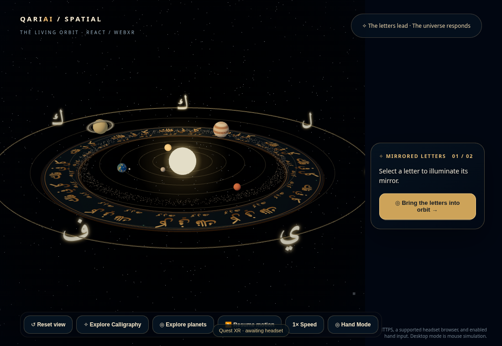
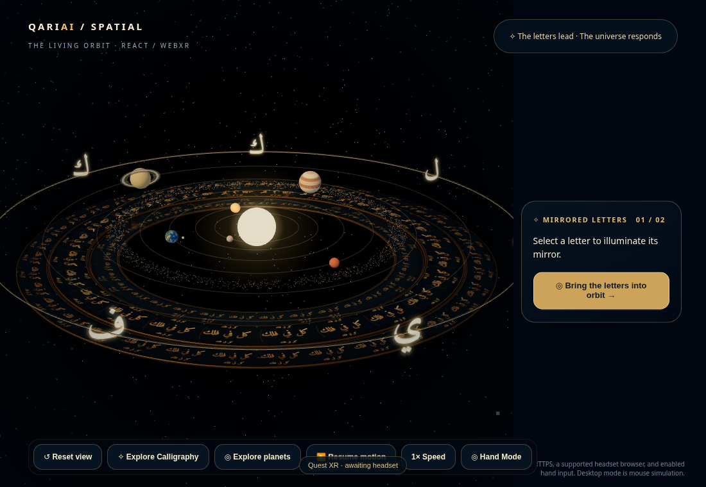
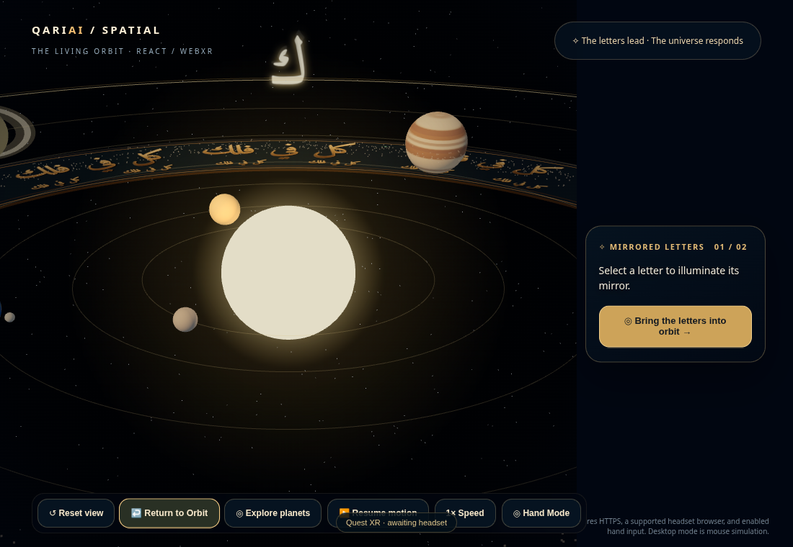
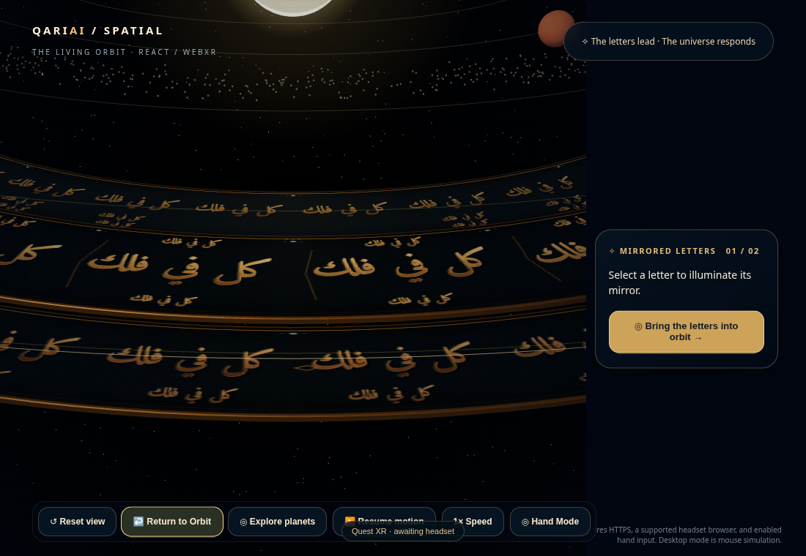

# v1.4.6 — concentric manuscript architecture

Branch `codex-calligraphy-v1.4.6` starts at the approved PR #9 baseline (`28a33ee`) and targets `codex-calligraphy-v1.4.5`.

## Composition

Three complementary recessed bands replace the single annulus. The inner border has compact script and selected regions of two-row marginal notes. The raised central gold band has larger cartouches, a three-part typographic rhythm, and facing micro-inscriptions. The outer bronze frieze has a separate scale, spacing and rivet ornament. All lettering uses the bundled Amiri and the complete, unvocalized excerpt `كل في فلك` from Qur'an 21:33; no extra verse or unverified text was added. Whole shaped phrases remain intact.

The surfaces have deterministic manuscript grain, metallic color gradients, recessed bump lettering and fine edge highlights. A batched bronze support has real sidewalls and bevels. The band elevations differ by up to 0.73 scene units; the highest face remains 8.22 units below the planet centers, below even Saturn’s tilted rings and the enlarged seven-letter planes. The script is bump-based engraving, not sculpted glyph geometry.

Polar UVs share one rectangular atlas. Glyph rasterization compensates for angular/radial UV scale, preserving the rendered contours rather than stretching the words along the circumference. Radial UV direction matches the face normal, with glyph tops facing inward rather than reflecting the Arabic. Atlas lanes have gutters, measured phrase widths, and no repeated-text multiplier. Human Arabic review of orientation and legibility is still required.

Turquoise accents sit along the moldings, separate from the letters' actual dots. One soft point system has 72 desktop points, reduced to 36 spatially distributed points in XR. Point size explicitly follows world scale; it does not become oversized when the XR root switches to 0.014 scale. Its restrained illumination pulse follows pause and speed controls.

## Desktop discovery

The v1.4.5 transition, input cancellation, free exploration and Reset behavior are retained. Explore's close framing now targets the front script band at world position `[0, -2.7, 44]` from `[0, 26, 78]`. The old close view targeted the Sun and left much of the nearby lettering below the viewport. Return still restores the home framing. The desktop camera rig remains disabled during XR.

The seven initial mirrored letters, two phases, Sun, six planets, Moon, orbital behavior, tracing, shortcuts, existing panel and Quest hand-tracking architecture remain. No header, inset, panel, phase, dependency or service was added.

## Resources and limits

The artwork uses five draws per view: three opaque faces, one opaque batched backing and one small additive point system. The main two textures are 4096×1024 with mipmaps: approximately 43 MiB, matching v1.4.5's two 2048×2048 textures. The 32×32 light mask adds 4 KiB. Unsupported texture dimensions are downsampled to the renderer limit; anisotropy is device-capped. Geometry and texture lifetimes are explicitly disposed, including temporary backing pieces.

The art contains 10,800 triangles (three 512-triangle faces and a 9,264-triangle support), versus 768 in v1.4.5. This is a deliberate cost for real stepped edges; it does not establish a headset frame-time guarantee. Actual Quest FPS, stereo readability, texture residency and hand behavior require hardware validation. No headset verification is claimed.

## Validation

`npm run build` and `git diff --check` pass. Vite's existing large-chunk warning remains. Desktop checks passed:

- Pointer selection through the art, mirrored highlighting and center-letter selection.
- Tracing/drawing/Escape, both phases, pause/resume, speed control and all six planet navigation states.
- Explore/Return, interruption by manual camera movement, Reset, shortcuts and desktop hand-mode.
- A shared atlas across all three faces and scale-aware point size under a simulated 0.014 transform (not a headset test).
- Bounding-box clearance below all seven enlarged letter planes, Jupiter and Saturn's complete geometry; decorative art produces no raycast hits.
- Positive, non-reflected UV orientation across all 1,536 textured triangles.
- No browser runtime errors in the final interaction checks.

| Metric at the initial view | v1.4.5 | v1.4.6 |
| --- | ---: | ---: |
| Scene draw calls | 54 | 57 |
| Scene triangles | 13,666 | 23,698 |
| Uploaded textures | 12 | 13 |

[Render budget data](v1.4.6/render-budget.json). Screenshots compare the same desktop viewport and initial camera. The close shots intentionally show each version's Explore framing; the focus change is part of this revision. Motion is paused during capture.

Software-rendered Chromium was used. Timing waits in the review harness allow for slow software frames; they are not performance measurements. Temporary diagnostic components are excluded from the committed application.

## Release

Draft PR only. The v1.4.5 branch and `main` are unchanged. No merge or production promotion is part of this work. Revert the v1.4.6 commit to restore the approved single-ring artwork and close framing.

## Desktop comparison

Both captures use 1100×760. The normal views show the initial scene; the close views use each version's Explore framing. The final captures show the initial, unselected letter state.

| View | v1.4.5 | v1.4.6 |
| --- | --- | --- |
| Normal |  |  |
| Close |  |  |
