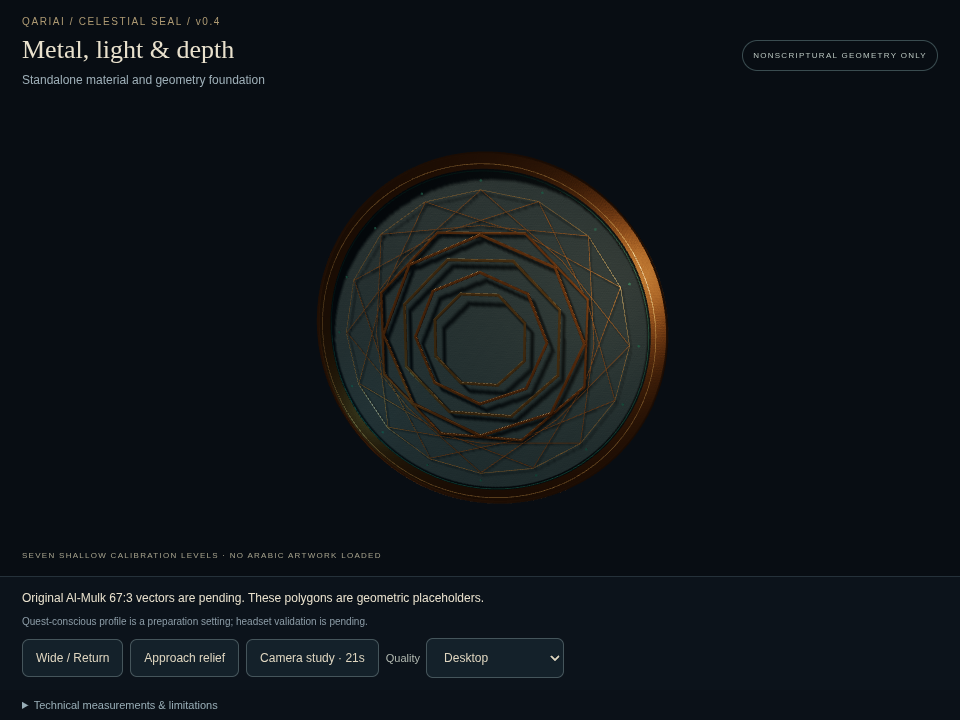
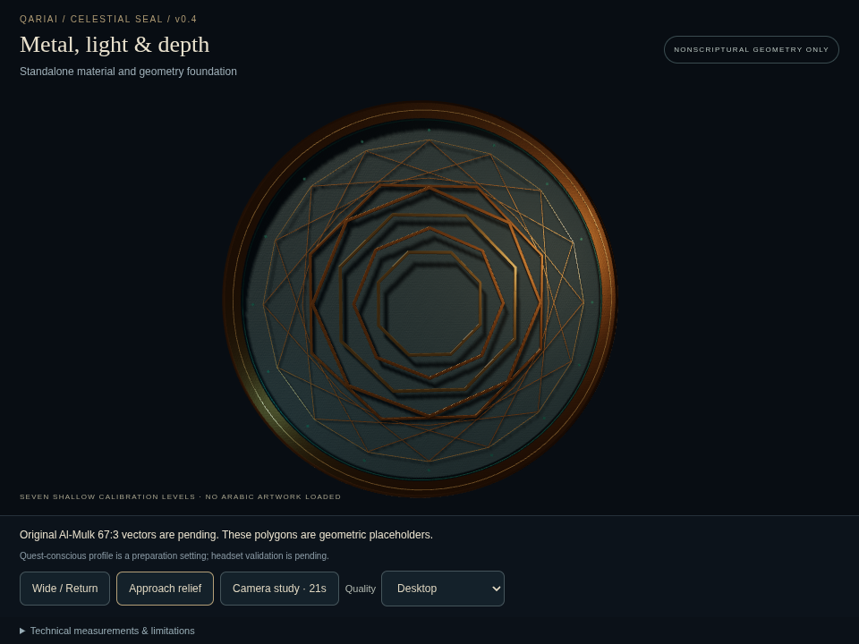

# v0.4 material and lighting review

Updated on 15 October 2026 in the **existing draft PR #27**, on `prototype/celestial-seal-v0.4-foundation`. Review baseline: `b3752db314f0988be271519a97cdcc5aa1ec5ee1`. This is still **NONSCRIPTURAL geometry only**. No Arabic asset, font or inscription is loaded, generated or reconstructed.

## Visual changes

- Warmer bronze base reflectance and restrained gold, with slightly brighter analytic studio reflections. No exposure, bloom or post-processing changes.
- Lower, warm directional key and reduced ambient fill reveal the real relief's shadow valleys. The existing warm fill and turquoise accent remain restrained. Shadow resolution, filtering and number of lights are unchanged.
- Seeded fine grain and quiet larger-scale surface variation feed the existing normal and packed roughness/metalness textures. Stronger slate normal response adds physical-looking texture without displacement. This is shaded detail, not extra sculpted geometry.
- Only calibration polygons receive muted vertex reflectance multipliers. The rim and fine filigree retain their warm highlights. RGB8 normalized vertex colours retain the same four material batches; no mesh positions or shapes change.

The finish is visibly warmer, with clearer raking shadows and less prominent central calibration contours. Under the warm key the slate reads as a dark, desaturated blue/charcoal. It remains a geometric material study, not a finished calligraphic sculpture. Physical-device judgement of metallic response, grain aliasing and shadow quality remains necessary.

## Genuine matched evidence

| State | Before: reviewed foundation | After: material polish |
| --- | --- | --- |
| Wide | [Original wide](../wide.png) | [Updated wide](wide.png) |
| Approach | [Original close](../close.png) | [Updated close](close.png) |

Both new images are actual native Chromium SwiftShader screenshots at **960×720**, the original viewport and unchanged settled camera presets. Capture uses CDP `Page.captureScreenshot` with `fromSurface:false`; no AI imagery, enhancement, compositing or rescaling. The original images remain intact for comparison. [Browser report](browser-check.json) records image SHA-256, live counters, test outcomes and timing limitations. These are local software-rendered desktop views, not Windows GPU or Quest captures, and they do not validate stereo comfort or hardware performance.

## Preserved geometry, camera and contract

[Preservation audit](preservation.json) compares both actual generated quality-profile meshes to the reviewed commit. Position, normal and UV typed arrays, topology, transforms and shadow flags are exactly equal. Seven nominal depth levels remain **−0.12 / −0.08 / −0.04 / 0 / +0.04 / +0.08 / +0.12**. Only a material colour attribute is added to the bronze/gold batches. Camera, controls and entry-page logic outside `Lights`, the depth/quality configuration, stylesheet and vector-intake safety contract are byte-identical.

The optional route remains `/celestial-seal-foundation.html`. Living Orbit, Harf Studio, historical seal, WebXR, recorder, competition film, existing public assets and Android are untouched.

## Actual resources

| Metric | Desktop | Quest-conscious preparation |
| --- | --- | --- |
| Main-render draw calls | 4, unchanged | 4, unchanged |
| Triangles | 9,578, unchanged | 6,274, unchanged |
| Renderer geometries / textures | 4 / 4, unchanged | 4 / 4, unchanged |
| Geometry attribute bytes before → after | 919,488 → 992,370 | 602,304 → 650,058 |
| Added RGB8 attribute bytes | 72,882 (~71.2 KiB) | 47,754 (~46.6 KiB) |
| Material maps incl. mipmaps | 699,051 bytes, unchanged | 174,763 bytes, unchanged |
| Prefiltered environment | 688,128 bytes, unchanged | 344,064 bytes, unchanged |
| Actual shadow target | 512², unchanged | 256², unchanged |
| Estimated maps + environment + shadow allocation | 3,484,331 bytes (~3.32 MiB), unchanged | 1,043,115 bytes (~0.99 MiB), unchanged |

Texture figures are estimates, not GPU memory queries: shadow estimate is 8 bytes/pixel; framebuffer, driver/program overhead and transient PMREM scratch are excluded. Main counters do not separately count shadow/PMREM passes. RGB8 attributes avoid extra draw calls, textures or custom shader code.

After screenshot capture, actual-render timing was sampled at **480×720** to bound software cost. Desktop completed **9/12 measured frames before its 20-second deadline**; Quest-conscious completed **12/12**. Mean CPU callback times were 10.22 / 3.33 ms; mean render-submission intervals were 1,594 / 1,462 ms. These slow, small software samples are not GPU timings, idle RAF rates, hardware benchmarks or a claim of Quest suitability. No repeated timing/capture attempts were made to obtain favourable results.

## Validation

- `npm run build`: passed; existing shared Three.js chunk-size warning remains.
- `node scripts/check-seal-materials.cjs`: exact geometry/camera/config/contract preservation passed in both profiles.
- `node scripts/check-seal-polish.cjs`: actual wide/close captures, render readiness, resource/depth assertions, camera approach/return/full study, both shadow allocations, reduced motion, mobile overflow, no Arabic/font/vector requests and no page errors passed. Partial timing is explicitly recorded separately from functional success.
- Original eight-excerpt verification, Harf tracing/pinch/body/dot/reset/session simulations and integration completion/navigation simulations passed.
- All five actual built entry pages and the original bundled font returned HTTP 200: [built-route report](built-routes.json). An initial smoke command used a nonexistent `Amiri-Regular.woff2` URL; correcting the test to the actual `Amiri-Bold.ttf` path passed without application changes.

Reproduction requires existing npm dependencies, Playwright and Chromium at `/usr/bin/chromium`. The geometry audit reads the baseline commit from Git history. Screenshot attempts have a ten-second bound and are not repeatedly retried after failure.

## Review boundary

Original independently approved calligrapher vectors and asset-specific approval/rights records are still missing. The vector contract is unchanged and no inscription loader is enabled. This page remains desktop-first; Quest stereo, thermal load, frame budget and material/shadow readability require actual headset testing. Stop for owner final material review. No merge or production deployment.
