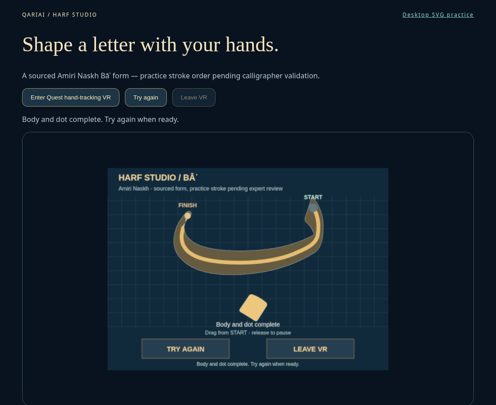
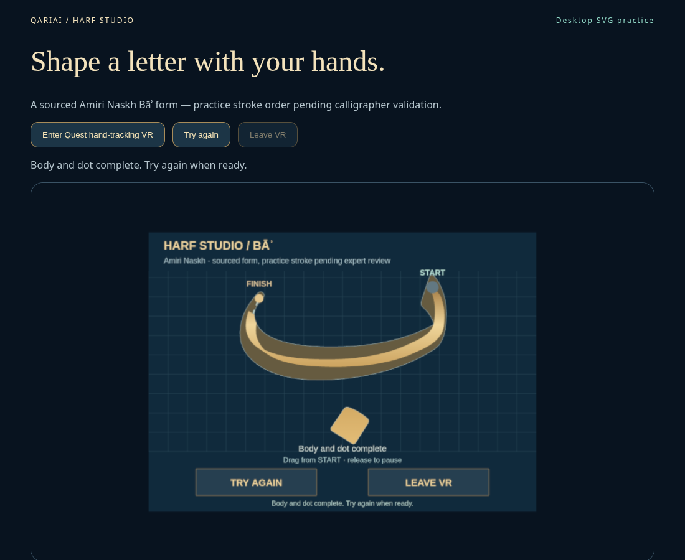

# Harf Studio v0.3 — broad-nib rendering study

Branch `prototype/harf-studio-v0.3-calligraphy`, based on PR #15 head `ae8d2a39d6058b7c31e52037e2742eeb04e4e9e0`. Only Bāʾ is included. Gemini's recommendations are provisional artistic guidance; no historical rule or expert validation is inferred from them.

## Audit: source geometry versus interpretation

| Element | Provenance / validation | Remaining uncertainty |
|---|---|---|
| Body outline and diamond dot | Exact uniformly transformed Amiri Bold 1.002 U+0628 contours; checksum and source/license retained | A typeface contour is not a certified teaching exemplar |
| Dot shape and placement relative to body | Font-derived; target lies inside source dot | Teaching dot-unit proportions and pen execution not specialist-approved |
| Centreline | Manually fitted five cubic segments; 505 points lie inside the source body | Not a font-provided stroke skeleton or certified pen trajectory |
| Right-to-left body sequence, then dot | Inherited digital learning sequence | Precise entry/terminal direction, lifts, pressure and traditional stroke order need Arabic calligrapher review |
| Uniform 0.6 display scale, board layout, checkpoints | Interface choices; original proportions retained | No canonical qalam/dot-unit proportion system is claimed |
| Nib span 25 px, thickness 4 px, nominal angle 35° ±3° | Provisional rendering choices only | Not a historical Naskh rule, actual pen orientation or measured pressure |
| Endpoint taper 45–100% over 18 board pixels | Display profile confined to source silhouette | Authentic nib mechanics and taper proportions unverified |

`ba.json`, its outline/dot coordinates, centreline, samples and copy are byte-identical to the base. `scripts/verify-harf-outline.py` passes again against the recorded unmodified source font. The [source audit](audit.json) distinguishes geometric correspondence from educational validation. The original OFL attribution and license remain included.

## Rendering and smoothing

`src/harf-xr/ink.ts` supplies **one** broad-nib path generator and gold palette to desktop SVG and XR Canvas2D. A short rectangular nib is swept between smoothed samples; its fixed orientation naturally gives direction-dependent apparent width. A ±3° tangent-based variation and small endpoint taper soften transitions. These effects are simulated; hand/wrist angle and pressure are not measured.

One corner-cutting pass smooths the *display* stroke, preserving endpoints and keeping interpolation within neighboring samples. Raw accepted samples, direction/proximity validation, scoring and thresholds remain unchanged. Tracking-jump rejection and the existing XR pose filter remain unchanged. Separate resumed strokes are not joined; taper is tied to the letter's global terminals, avoiding a false taper at every pause.

Both renderers consume the same compound vector path in the existing 900-unit board coordinate system and the same gold stops. They clip practice ink to the original body contour. **The reference silhouette itself is never deformed.** The sourced diamond dot remains a separate second step and receives the shared gold finish only after placement. No new letters, controller haptics, decorative flourishes, particle effects or GPU resources are added.

## Before / after evidence

| Before: v0.2 uniform 12 px trail | After: v0.3 broad nib and gold shading |
|---|---|
|  |  |

The before image is retained verbatim from the exact base commit's validated desktop screenshot, not recreated. The after image is a fresh capture using the same 1100 × 900 viewport, unchanged camera/board, body-and-dot completed state and pointer flow following simulated denied XR entry. This is a consistent visual comparison, not a fresh simultaneous browser pair or pixel-perfect GPU comparison. Both are desktop screenshots, not headset evidence.

[Fresh SVG desktop view](svg-complete.png) uses the same renderer/data. The initial SVG capture exposed a native SVG-point copying bug in the new smoothing helper. Explicit coordinate copying and an inherited-getter regression fixed it; the linked captures are from the corrected, passing run.

Visual assessment: the new trail is fuller in the bowl, changes width toward the terminals and has restrained gold/bronze variation. The source outline remains visible around untraced areas. This is a simulated broad-nib ink treatment, not a verified reproduction of historical penmanship or physical metallic lighting.

## Validation and budget

- Production build / TypeScript: passed; inherited large Three.js chunk warning remains.
- Existing tracing/pinch/session regressions: passed.
- Ink checks: width variation, finite/empty/duplicate input, inherited SVG coordinate getters, smoothing and endpoint preservation passed. Validation samples are unmodified.
- Source audit: exact contours, 505 interior centreline points, interior dot target passed.
- Desktop SVG body/dot/reset/guide and spatial pointer body/dot/retry: passed.
- Denied hand-feature entry, narrow layout and page-exit smoke check: passed; no JS errors.
- Scope checks: Living Orbit, letter definition, tracing engine and session module unchanged. Spatial input, placement and teardown retain their existing code; only its painter imports/rendering change.

Commands: `npm run build`, `node scripts/check-harf-xr.cjs`, `node scripts/check-harf-ink.cjs`, `node scripts/check-harf-desktop.cjs`, and `python3 scripts/verify-harf-outline.py /path/to/unmodified/Amiri-Bold.ttf` (fontTools development dependency).

GPU budget remains one 900 × 650 RGBA canvas texture (~2.98 MiB with mipmaps), up to four draws, existing 50 joint instances and ~4,050 triangles. DPR/anisotropy caps and disposal remain intact. Broad-nib hull generation and vector parsing add CPU work on ink updates; real Quest cost is unmeasured. Screenshot tests use batched pointer moves with real pointer down/up; they do not prove real-time input smoothness.

Qualified Arabic calligrapher review remains required for proportions, direction, stroke order, pen angle, taper and educational use. Real Quest reach, pinch usability, tracking loss, binocular sharpness, headset frame time, prolonged tracing and controller-free retry/exit remain pending. No manual Vercel deployment was performed; live branch preview remains unverified. No Living Orbit/main/Android changes, production deployment or merge.
