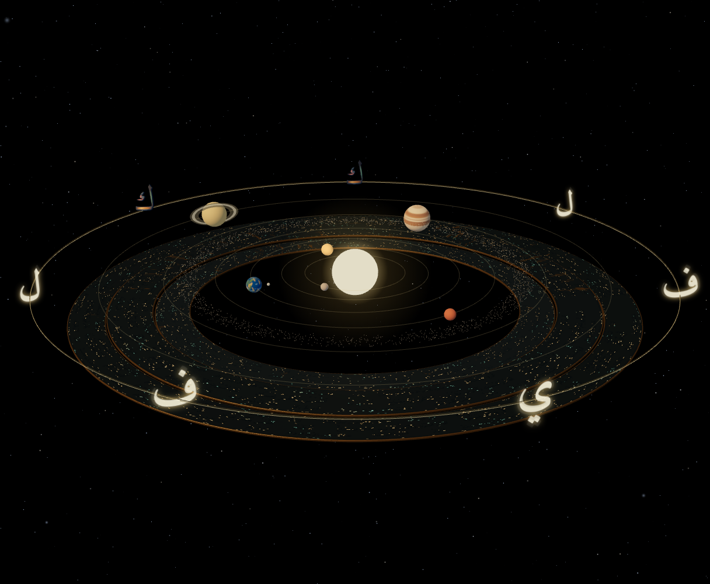

# Living Orbit — sculptural kāf and soft starfield integration preview

Isolated branch `prototype/orbit-sculpture-starfield-v0.1`, based on the approved study head `7980a3e1cd2e3de4f2af073ae9a1000b4d14e454`. Draft targets `prototype/spark-letter-study-v0.1`; no earlier branch/PR is changed. This is the first in-scene visual feasibility review, not final artwork or Quest release approval.

## Current — material visibility revision 2

[Targeted kāf visibility update, genuine matched views and unchanged resource counts](visibility-v02/README.md). The shared sculptural faces now have stronger local material response and a small pigment-mapped surface-emission floor. Geometry, scene lighting, background and choreography stay fixed. Earlier captures below are the initial, darker integration.

## Open the existing experience

Use the branch preview's root with **`/?calligraphyRelief=texture&orbitArt=study`**. Remove `orbitArt=study` for the original view. Invalid/duplicate values remain original. The mode is carried through internal Orbit → Harf → Orbit links; no return URLs, external navigation or arbitrary query forwarding.

There is **no new Letter / Light link, panel or section in the experience**. The existing study route remains a developer reference. Harf's art and tracing remain unchanged in this iteration; only its existing shared navigation helper carries the strictly allowlisted mode.

## What changed

- Both existing mirrored ك positions use the exact Finish 13 Amiri curves, detached component, inward bevel, crowned cap, palette and packed surface treatment. One geometry/map set is shared between them; materials are independent so the existing paired-selection state is visible.
- The original 14-unit face scale, source baseline, orbital positions, billboard behavior, motion and 1.32 selection scale are retained. Transparent hit targets remain. Other five letters are unchanged.
- Finish 13 is adapted to the application's existing Three 0.160 renderer. No Spark renderer, sorting pass, second Three version, new scene or studio light rig enters Living Orbit. A small local material reflection map replaces the standalone study's studio environment; the global environment and existing lights do not change.
- The two original seeded star shells retain all 6,600 positions and original XR draw-count reductions. Shader-defined soft circular dots add low-amplitude twinkling, cool white with sparse warm accents, and very slow desktop rotation. Pause freezes all of it. Field rotation stops in XR for comfort; twinkling continues unless paused.
- Particle size uses actual world scale and the active XR eye viewport, with a hardware-bounded 16-pixel maximum. No per-frame CPU position rewrite or star texture. The belt remains untouched.

## Initial integration rendering evidence

[Wide](wide.png) · [Selected mirrored kāf](selected-kaf.png) · [Explore Calligraphy](explore.png)

These are native canvas captures of the full application, not composited illustrations. The test uses the existing deterministic stepping technique, with development StrictMode replaced by Fragment **in the harness only** to avoid duplicate atlas baking. Application cameras, geometry, shaders and gesture validators are not substituted. GPU drawing is enabled for these captures.

At the initial integration commit, the letters were visibly **darker than the original glowing sprites at normal orbital distance**; the targeted revision above improves visibility without changing scene lighting. Their fine surface channels are too small to judge there. This preview demonstrates integration and sharing, not final visual balance. Owner review is required before extending the treatment to the remaining letters. The animated background follows the reference's general softness/depth direction, not an exact Spark asset reproduction.

## Validation

[Validation summary](validation.json) · [Full scene](browser.json) · [XR uniform tests](star-xr-tests.json) · [Source audit](source-audit.json)

Passed: production build; TypeScript; eight source-verified Qur'anic excerpts; exact native masks at 55/100/190px; original helper/contour copy checks; real full-scene WebGL rendering; mirrored selection and scale; exactly two phases; background Pause/Resume; original Explore/Return camera endpoints; safe Harf links; shared geometry; body, separate dot, retry, session and ink regressions; desktop SVG/spatial tracing; existing menu/recovery logic; all three built pages and local Arabic font HTTP 200.

XR tests exercise the **actual new component callbacks** against real Three objects for normal, smaller/larger world scales, viewport size, exit/re-entry, pause and original star-position hashes. They are not full-scene headset/emulator render evidence. Physical Quest stereo, visual comfort, sustained frame time, tracking and thermal behavior remain pending.

The old PR32/33 scope scripts reject the intentional integration changes because they require the entire App to match their historical baselines. They were not weakened or marked passing. The new scope guard pins this iteration's true baseline and verifies unchanged original Stars/Belt, planetary code, camera, WorldAnchor, hand/menu/session handling and letter choreography.

Two earlier harness problems are retained in [harness notes](harness-note.json) and failure reports: an assumed Billboard wrapper depth, then a manual clock reset on every frame. Neither required application fixes. The final candidate run passed with no page/shader errors. An external UI-font stylesheet is replaced with empty CSS in the harness; authoritative local Amiri remains loaded and tested.

A separate original-view comparison reached a 60-second readiness timeout with no browser errors. [That failed run](baseline/browser.json) is preserved; no repeated lengthy baseline captures were made. There is no matched baseline resource/FPS claim.

## Resources and performance limits

[Measured/estimated resources](resources.json). Candidate desktop Wide: **59 draw calls, 47,566 submitted triangles, 8,472 points**; renderer tracks 40 geometries / 14 textures. GPU geometry buffers total 2,554,532 bytes. Material texture estimate is about 54.33 MiB; this excludes some renderer/driver overhead and is not measured VRAM.

The shared letter asset is **11,940 triangles / 1,146,240 geometry bytes** allocated once; drawing it twice submits 23,880 triangles. Its two surface maps estimate 2,359,296 bytes with mipmaps; the local reflection atlas is 336×256 half-float RGBA (688,128 bytes). New per-star seed attributes add 26,400 geometry bytes, with no new star positions or textures.

The candidate's one-time letter asset preparation took about 1.0 seconds in the recorded software run (map generation about 0.67 seconds). These values are environment-dependent, not Windows/Quest benchmarks. React development StrictMode can initialize and dispose resources twice; production uses a single mount. Reset recreates assets intentionally. Detailed surface rendering adds draw/fragment cost; **Quest acceptability is unproven**.

## Reproduce and review

1. Serve Vite and open `/?calligraphyRelief=texture&orbitArt=study` on the branch preview.
2. Compare with `/?calligraphyRelief=texture`.
3. Select either ك: both should scale/highlight. Test both phases and Pause/Resume.
4. Use existing camera controls to inspect, then Explore Calligraphy/Return.
5. Open Harf, trace ب body and separate dot, then return; both validated visual parameters should survive.
6. Check on physical Quest before any release or rollout to other letters.

Automated: `node scripts/check-orbit-art.cjs`, `node scripts/check-orbit-art-xr.cjs`, `node scripts/check-orbit-art-browser.cjs`, existing integration/Harf/menu/content suites, `npm run build`. The browser harness is bounded at 180 seconds; screenshots have separate 20-second optional limits. Baseline-only mode is `ORBIT_ART_BASELINE=1 ORBIT_ART_OUT=docs/orbit-art-v01/baseline node scripts/check-orbit-art-browser.cjs` (previous timeout documented above).

No Qur'anic ring/text/material changes, new phases, new planets, camera redesign, Harf tracing changes, competition footage, Android, main or production changes. No merge or production deployment. Stop for owner visual review.
