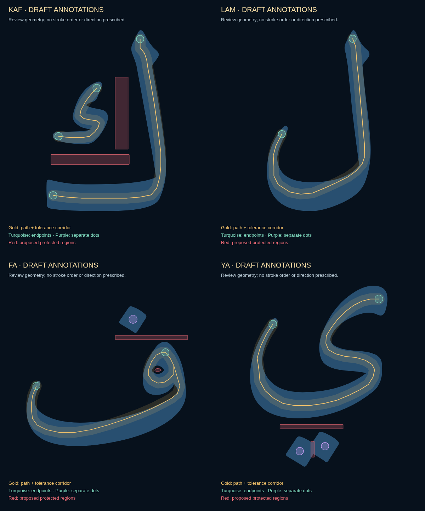

# Draft annotations for four existing Harf guides

Base: `0e1fa7ce96e94d6af2ad18a14dbf937d91239933`. These are concrete review candidates for the approved guide-following proposal. They are not enabled in the application and are not specialist-certified teaching paths.

## What to review

The sapphire silhouette is each exact original font-derived outline. Gold lines are candidate practice centrelines, surrounded by the proposed tolerance corridor. Turquoise circles are endpoint regions, purple circles are separate dot regions, and red polygons are protected regions. There are no arrows, stroke numbers or prescribed direction/order.

| Letter | Annotation | Vector view |
| --- | --- | --- |
| ك | Main body and detached component; two protected separation bands | [Kāf](kaf.svg) |
| ل | Upright and bowl as one continuous candidate body path | [Lām](lam.svg) |
| ف | Head loop and bowl; separate upper dot; protected inner counter and dot/body gap | [Fāʾ](fa.svg) |
| ي | Curving body; two separate dot regions; protected body/dot gap and separator between dots | [Yāʾ](ya.svg) |

The yāʾ source stores its dot pair in one compound contour with a connecting waist. The proposed red separator crosses that waist to disallow drawing one connecting stroke as a substitute for two intentional dots. This is a validation proposal only; the original source path and artwork are unchanged. This particular rule needs explicit review.

All paths were authored as geometric review candidates. They were checked against the source fills and adjusted at the narrow terminals; they were not extracted from an authoritative pen trajectory. The fāʾ head loop revisits a small section before joining the bowl. Review whether that route is appropriate for this guide-following exercise; the engine does not require that drawing order.

## Machine-readable data and candidate fixtures

[candidates.json](candidates.json) contains original source-coordinate paths, endpoint/dot disks, protected polygons, source hashes and proposed thresholds. Every record has `annotationsApproved: false` and `fixturesApproved: false`. The live registry in `src/harf-xr/guide-validation/reviews.ts` remains unchanged with all four entries `null`. Query parameters and local storage cannot activate these candidates.

The corridor radius is 2.5% of the original glyph bounding-box diagonal; sample spacing is 0.4%. Candidate thresholds are 90% required path coverage, both endpoint regions, all required dots/components and 95% ink length inside allowed regions. A tolerance band can extend beyond a narrow source stroke; it does not enlarge the artwork. Dot disks are individually authored and disjoint.

[fixtures.json](fixtures.json) contains 47 reproducible algorithmic candidate cases. Positive cases follow the proposed paths, make a small geometric offset, or reverse their direction. Negative cases include blank/tap-only sheets, canceled traces, body shortcuts, missing body sections/components/dots, extra ink, crossings of protected regions and one stroke substituted for two dots. These are generated geometric examples, not collected human handwriting or independent specialist acceptance evidence.

[checks.json](checks.json) records real Chromium SVG fill checks: exact source path bytes, all sampled candidate path points and dot centres inside their source fill, and the original fāʾ counter remaining open. The screenshot is the actual rendered SVG review sheet, not a screenshot of an activated Harf validator or a 3D reveal.

## Reproduce

Run `python scripts/render-guide-annotations.py` to rebuild the SVGs from the candidate JSON and unchanged source paths. Run `node scripts/check-guide-annotations.cjs` to check source identities, exercise candidate fixtures with test-only approval copies, verify SVG fills and capture the review grid. Test-only approval records are never saved into candidate data or the live registry.

Before activation, review the proposed routes, narrow terminal tolerances, endpoints, semantic dot regions, protected separators and expected outcomes against accepted and rejected handwritten traces for mouse/touch/stylus. Record the accepted annotations and calibrated fixtures with a review reference. Passing the implementation tests alone does not establish that review.

This update changes only developer review artifacts, their generation/check scripts and the scope check's explicit script allowlist. Application modules, original outlines/font, artwork, Bāʾ, history and completion activation are untouched. No application rebuild was needed for these documentation-only runtime-independent additions. No merge or production deployment.
