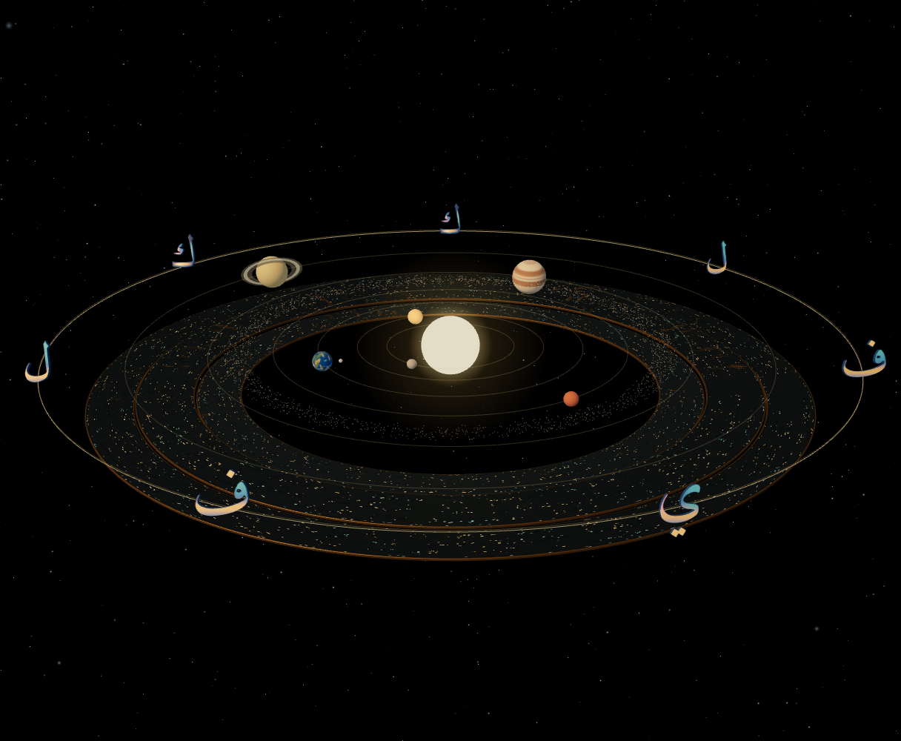

# Seven sculptural letters — original Amiri extension

Baseline: `8c64365d7437d0f8db311e41c7f78859d016d6f0`. Extends the reviewed ك treatment to the existing ل، ف، ي on isolated draft PR #35. No new user-facing section or experience phase.

Preview: https://qariai-spatial-git-prototype-orbit-scul-35f50e-qariais-projects.vercel.app/?calligraphyRelief=texture&orbitArt=study

## Exact Arabic source and mark integrity

The new outlines are direct `fontTools.SVGPathPen` output from the **unchanged original Amiri Bold** font: ل U+0644, ف U+0641, ي U+064A. Font SHA-256 remains `65e3e6fe6af66bb6d24959bd537a89ea35de14083f5a2e2290c246136c2b047b`. `scripts/extract-orbit-letters.py --check` reproduces every path, source hash, advance, bound and contour count. No tracing, simplification, fabricated joins or substitute font.

[Native/vector mask and geometry checks](integrity.json) compare the real browser-shaped font with the exact path in the same 256×256 coordinate system. All three retain solid native coverage and leave native gap cores unfilled outside a one-pixel AA neighborhood. Threshold IoU is approximately 0.97–0.99; it is not claimed byte-identical because browser hinting/rasterization differs. The authoritative curves are exact. Projected cap area remains unchanged to within 2e-8 world units squared after Z-only crown refinement.

| Glyph | Native/vector masks | Original outer components | Counters | Triangles | Geometry bytes |
| --- | --- | ---: | ---: | ---: | ---: |
| ل | [Native](ل-native.png) / [Vector](ل-vector.png) | 1 | 0 | 7,212 | 692,352 |
| ف | [Native](ف-native.png) / [Vector](ف-vector.png) | 2 | 1 | 9,144 | 877,824 |
| ي | [Native](ي-native.png) / [Vector](ي-vector.png) | 2 | 0 | 9,732 | 934,272 |

The original Amiri ي represents its dot pair within one compound source component. Component count is not semantic dot count. Both original dot forms and their positions remain unchanged; no splitting, reshaping or repositioning was introduced. ف's dot and enclosed counter remain intact. All text/dots stay attached under one rigid glyph transform.

## Shared material language, preserved geometry

- Keep the reviewed ك contours, surface maps and visibility coefficients unchanged.
- New glyphs use the same extrusion depth, inward bevel, Z-only crown, original 14-unit face scale, source advance and native baseline (156.25 pixels for all).
- Use the same sapphire sidewalls and interior field, amber stroke/dot accents, restrained teal/coral satin variation and shallow inset shading. The new material regions derive only from source-interior coverage; they are nonscriptural surface ornament, not invented Arabic strokes.
- One asset per distinct letter, reused by its mirrored positions; one local reflection map shared across all four. Independent material feedback preserves each pair's selected state. Original hit targets and billboard behavior remain.
- The cache guard is 20,000 triangles / 2 MiB per distinct glyph and 60,000 / 6 MiB for the unique collection. Actual total: **38,028 triangles / 3,650,688 bytes**.

These are provisional font-derived calligraphic sculptures, not bespoke or historically authenticated calligrapher artwork. The existing Qur'anic orbital inscriptions and their source/texture treatment are entirely untouched.

## Genuine full-scene evidence

[Wide](wide.png) · [Selected ك pair](selected-kaf.png) · [Explore Calligraphy](explore.png)

All seven now share a coherent sapphire/gold sculptural appearance. Each ف dot and ي's dot pair, the detached ك component and original body shapes remain visible. At orbital distance the gold regions and silhouette carry the visual identity; fine engraving still requires close inspection. Owner visual approval is outstanding.

The bounded actual WebGL run passed all **seven** keyboard selections, including each mirrored pair and centre ي, original selection scale and reset of nonselected letters. Both phases, background Pause/Resume, exact Explore/Return endpoints and internal Harf link also pass, with no page/shader errors. See [browser report](browser.json). An initial harness assertion ran before the next React selection had settled; [its failure report](browser-selection-harness.json) is preserved. The final run waits for the same exact scale assertions, without application or validator changes.

## Measured resource comparison

[Resources](resources.json), same paused wide camera:

| Resource | Previous ك-only integration | All seven |
| --- | ---: | ---: |
| Draw submissions | 59 | 60 |
| Submitted triangles | 47,566 | 89,980 |
| Points | 8,472 | 8,472 |
| Renderer geometries | 40 | 40 |
| Renderer textures | 14 | 15 |
| Geometry buffers | 2,554,532 bytes | 5,058,280 bytes |
| Material texture estimate | 56,965,802.67 bytes | 62,296,064 bytes |

The complete four-letter surface-map set estimates 9 MiB with mipmaps, with one shared reflection atlas of 688,128 bytes. More letter maps replace the old individual sprite textures, so the uploaded texture count rises by one. Counts are actual desktop render submissions; memory is an estimate, not driver VRAM. No measured Quest FPS or stereo throughput claim. The increased PBR/triangle workload and startup need physical Quest testing before promotion.

## Tests and review

[Validation](validation.json) · [Source audit](source-audit.json). Production build, exact font extraction, native raster/counter checks, cap area, scope/source preservation, source-verified Qur'anic content, full scene/selection checks and focused Harf tracing/session/ink, recovery, menu, navigation and starfield XR-uniform regressions are recorded.

Reproduce: `python scripts/extract-orbit-letters.py --check`, `node docs/orbit-art-v01/letters-v03/probe-geometry.cjs`, `ORBIT_ART_OUT=docs/orbit-art-v01/letters-v03 node scripts/check-orbit-art-browser.cjs`, `node scripts/check-orbit-art.cjs`, `npm run build`.

The mask/geometry probe is CPU-only Chromium with the original font and actual Three tessellation. Scene captures use the existing deterministic software-renderer harness, not a real Quest. No changes to camera, background, scene lighting, planets, seven-letter order, mirrored logic, phase structure, Harf validator, competition footage, Android, main or production. No merge or production deployment. Stop for visual review.
