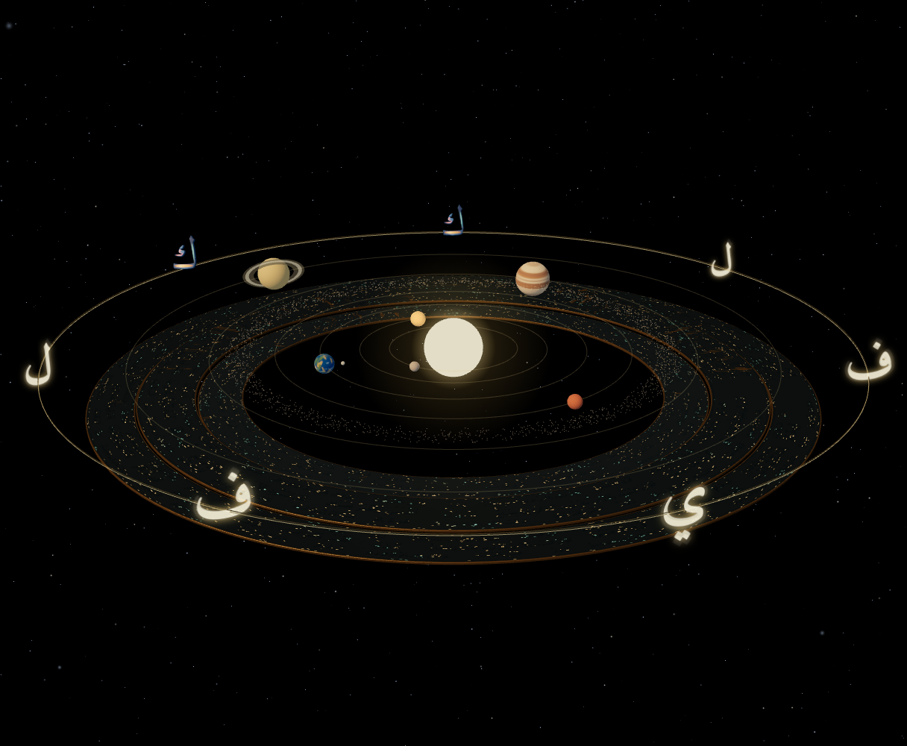

# Kāf visibility revision 2 — targeted material response

Baseline: `114f5316b95a79d2154c8ddbc1840bfe3b1708f4`. Owner review found both sculptural ك letters too dark beside the existing five glowing letters. This revision modifies **only the two kāf materials and their paired-selection feedback**. It stays behind the existing `orbitArt=study` opt-in on draft PR #35.

## What changed

- Face albedo gain 1.6 in linear RGB and local reflection intensity 2.6 (previously 1.1).
- A bounded, surface-only emission floor of 0.45 reuses the **same pigment map**. This preserves sapphire/amber/coral/turquoise proportions rather than replacing the face with flat ivory. Selection raises it to 0.75.
- Sidewall local reflection intensity 1.6, with a sapphire floor of 0.18 / selected 0.32.
- No bloom, silhouette shell, additional light, colour region, texture allocation or global scene illumination. Tone mapping and exposure remain untouched. The emission is explicitly a visibility aid, not a simulation of engraved depth; the original bump and metallic response still provide surface shading.

The exact geometry, source contours, detached component, proportions, framing, choreography, shaders for the starfield, all lights, local reflection image, three Qur'anic rings, remaining letters, navigation and Harf are unchanged. [Source audit](source-audit.json).

## Genuine matched evidence

| View | Before | After |
| --- | --- | --- |
| Paused wide | [Original integration](../wide.png) | [Visibility revision](wide.png) |
| Selected pair | [Before](../selected-kaf.png) | [After](selected-kaf.png) |
| Explore Calligraphy | [Before](../explore.png) | [After](explore.png) |

Both kāf silhouettes and their gold bases are visibly easier to distinguish against the black field in these captures. The sapphire faces remain coloured and the other five letters retain their original appearance. The result is not intended to match their old sprite halos. Fine engraving is still too small to judge from the orbital wide view; final material balance requires owner review on the preview and actual Quest testing.

These are native full-scene canvas captures under the same bounded deterministic Chromium/SwiftShader method as the initial integration. Camera endpoints, draw counts and allocations match exactly; no compositing or application geometry substitution. The test's manual clock correction remains harness-only and is documented in the parent report.

## Validation and costs

[Full browser run](browser.json), [matched resource comparison](comparison.json), [validation](validation.json).

Full scene passed with no page/shader errors: mirrored selection and scale; exactly two phases; original Explore/Return endpoints; background Pause/Resume; internal Harf link; original shared geometry. Scope/source and eight-excerpt Arabic checks passed. Production build status is recorded in validation.json.

Wide remains **59 draws, 47,566 triangles, 8,472 points, 40 renderer geometries and 14 textures**. Geometry bytes remain 2,554,532 and material texture estimates remain 56,965,802.67 bytes. Both kāfs continue to share their 11,940-triangle geometry / 1,146,240 bytes and original maps. The material shader now samples its existing pigment map for emission as well as albedo: **one extra material texture lookup**, no added draw or texture allocation. Equal resource counts are not a claim of identical GPU time. No controlled Quest FPS/VRAM measurement or new full XR stereo test.

Physical Quest rendering, sustained performance and owner visual approval remain outstanding. No changes to other PRs, main, production, Android or competition footage. No merge or production deployment.
