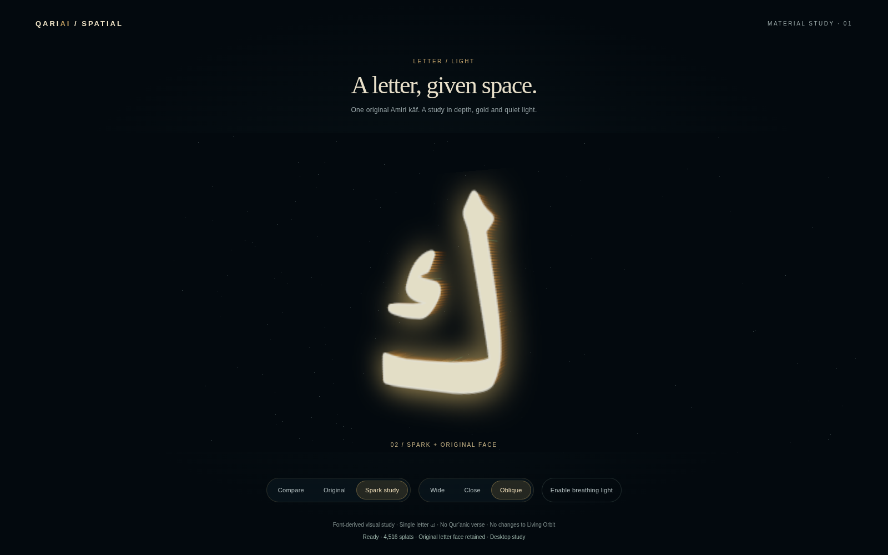

# Letter / Light — isolated Spark feasibility study

Base: PR #33, `ad10ee39ee0f16262e7b3654b24bad23a34351ff`.
Branch: `prototype/spark-letter-study-v0.1`.
Opt-in route: `/spark-letter/index.html`. No menu link is added to the existing applications.

## What this proves

The existing Amiri **ك** face can coexist with a small, shallow Gaussian-splat shell using the real Spark renderer. The original and hybrid share one immutable native-face texture. Four mask-sampled depth courses add bronze/gold edges and occasional restrained turquoise samples. Wide, Close and Oblique controls provide matched comparisons; optional breathing light changes the shell tint by ±3.5%, never the letter face. Motion is off initially. Reduced-motion preference makes camera transitions instant.

This is a conservative **font-derived study**, not bespoke Thuluth, an approved calligraphic composition, a reconstructed 3D glyph or a Qur'anic inscription. No text-to-image model, invented ligatures, substituted font, new verse or letter sequence is involved. The single code point is U+0643.

**Visual assessment:** the frontal improvement is deliberately modest because the original face remains authoritative. The oblique view visibly exposes shallow gold/bronze depth, but edge courses remain somewhat ribbed and the inherited 256px face softens when magnified. The shell has assigned colors, not a physically lit metallic BRDF or genuine cast relief shadows. It does not yet match the sophistication of a finished sculptural calligraphy asset. Do not expand this to all letters or replace the approved Orbit treatment without visual approval. Spark alone does not supply authentic calligrapher-designed geometry.

## Genuine comparison evidence

All images below are uncomposited Chromium screenshots of the actual application/Spark rendering, at 1600×1000, with breathing light off. Original and hybrid use identical camera/projection endpoints for each view. The existing original-face pixels and a deterministic background are shared.

| View | Original | Spark-assisted |
| --- | --- | --- |
| Wide | [Original](original-wide.png) | [Hybrid](hybrid-wide.png) |
| Close | [Original](original-close.png) | [Hybrid](hybrid-close.png) |
| Oblique | [Original](original-oblique.png) | [Hybrid](hybrid-oblique.png) |




The first framing experiment clipped the letter and was corrected before these final images. A subsequent recapture hit an 18-second animated-camera settling timeout on SwiftShader; its diagnostic is retained in `framing-recapture-timeout.json`. Final capture uses fixed endpoints through a test-only-facing study API, without skipping GPU draws or changing the source face. All seven final screenshots succeeded. No emulated or physical hand input is claimed; this page is a desktop visual study. Camera UI remains smoothly animated during ordinary use.

## Arabic and source provenance

- Existing routine: `src/App.tsx`, `arabicTexture`, at the pinned base. `public/spark-letter/source-letter.js` preserves its drawing commands and coordinates; only TypeScript syntax/export are adapted.
- Font: unchanged bundled `public/fonts/Amiri-Bold.ttf`, SHA-256 `65e3e6fe6af66bb6d24959bd537a89ea35de14083f5a2e2290c246136c2b047b`; existing OFL in `public/fonts/OFL-Amiri.txt`.
- The native canvas is read once and frozen into a shared RGBA DataTexture. This avoids repeated Canvas GPU/CPU readback rounding of faint glow pixels. sRGB, original dimensions, filtering and vertical UV orientation are retained.
- In the final controlled software-Canvas run, all **262,144 RGBA bytes** match an independently evaluated copy of the unchanged original drawing routine: zero differing bytes, including alpha. The RGBA upload is unchanged after splat construction and view changes.
- A separate shadow-free sampling mask uses the same font, anchor, size and stroke. It never modifies the original face. At alpha ≥128 its two connected components contain 3,751 and 1,135 pixels, preserving the detached internal kāf component.
- Every splat center is sampled from coverage ≥230. Smaller edge splats limit spill. Gaussian support is soft: this center test is **not** a proof that every rendered Gaussian tail lies inside the glyph. No source contours are altered, and this is not an approved method for representing fine Qur'anic marks with splats alone.
- Runtime/source hashes are recorded in `browser-report.json`. Native rasterization hashes are renderer/platform-specific; do not treat the SwiftShader hash as a universal Windows/Quest font signature.

## Dependency isolation and reproducibility

Living Orbit remains on Three 0.160.1. Spark 2.3.1 requires Three ≥0.180.0, so the independent static page vendors Three 0.180.0 and Spark 2.3.1 via a page-local import map. Root package.json, lock state, Vite configuration and all application sources are unchanged. The study has no runtime CDN dependency and no external font request.

Published npm modules are unmodified. Versions, tarball URLs, SHA-256 checksums, per-file sizes/hashes and MIT license texts live in `public/spark-letter/vendor/`. The source distribution currently advertises newer documentation examples; 2.3.1 was the npm release available for this proof. Vendor updates must be deliberate and revalidated; this static vendoring is suitable for a reproducible prototype, not a recommendation to carry a second Three version into the integrated scene.

All study assets total **4,702,513 bytes** before transport compression in this revision (see current `resource-summary.json` for authoritative totals). They are loaded only on the opt-in route. The original application's eight built JS/CSS assets are byte-identical to the pinned baseline build; the public study is copied alongside them by the unchanged production build.

## Resource and timing evidence

- **4,516 splats**, maximum generation guard 12,000. Four sample depths from −0.22 to +0.095 study units; not a measured physical extrusion or headset-scale object.
- Packed used payload **72,256 bytes**; packed CPU capacity **131,072 bytes**. Spark renderer ordering capacity is **16,384 splats**. Those are distinct quantities.
- The same comparison runtime reports original-only **3 calls / 4 triangles**, hybrid-only **4 calls / 9,036 triangles**, and side-by-side **6 calls / 9,040 triangles**. The shell contributes 9,032 submitted triangles (two per splat), not 9,032 stored contour triangles. Original-only still retains Spark's allocated runtime and is not an engine-free Orbit performance baseline.
- Scene geometry-array inventory: **3,320 bytes**; uploaded geometry/texture counts in the final run: **4 / 8**. These are browser counters and visible geometry-array sizes, not total worker, engine, framebuffer or driver memory.
- Enumerated face/packed/ordering/accumulator texture estimates are approximately **0.55–0.67 MiB**, varying with retained accumulator state. This is an incomplete uncompressed estimate, not measured VRAM. See dimensions/type/depth in `browser-report.json`.
- Final single-page JavaScript-ready time: **3.65 seconds**, excluding completion of every deferred shader/GPU task. It is not time to stable first presentation.
- Sparse pre-capture SwiftShader samples: original wide ~106.5 ms, hybrid wide ~107.5 ms; original close ~126.9 ms, hybrid close ~103.9 ms. These short, asynchronous software samples are **not proof of equal performance**, an optimization, Windows results or Quest FPS. Compare mode ~281.8 ms has only three retained interval samples.
- Measurements precede screenshots, and the capture helper excludes post-readback samples. Spark's own necessary GPU/worker sorting remains part of the real rendering path. No manual finish/readPixels instrumentation is used in these timing windows.

## Checks

`node scripts/check-spark-study.cjs` validates real Spark initialization, source-byte identity against the original drawing routine, detached component retention, sampling centers, budget, matching camera endpoints, unchanged source upload, breathing-light controls and narrow layout. It captures the seven genuine images with bounded optional screenshots. It does not validate physical Quest stereo, hands, comfort or sustained thermal performance.

Also passed: production TypeScript/Vite build (inherited >500 kB chunk warning), eight recorded Qur'anic content spans, Harf body/dot/direction/session simulations, broad-nib/smoothing checks, integration navigation/completion, spatial menu state and independent pinch recovery checks. Existing application assets and source are unchanged; no full celestial scene rendering test was repeated for this isolated page.

Run from the repository root:

```sh
npm run build
node scripts/check-spark-study-scope.cjs
node scripts/check-spark-study.cjs
```

The browser script needs Playwright available as in the existing project checks; use CHROMIUM_PATH on Windows. It currently uses an explicit SwiftShader lane for reproducibility. Do not describe that run as Windows hardware acceleration or Quest validation.

## Review boundary

Open the branch preview's `/spark-letter/index.html`, then inspect **Compare → Spark study → Close → Oblique → Original**. The form and face should remain recognizable while oblique depth changes. A shader-based metallic face, high-resolution replacement face, new letter geometry, many-letter migration, WebXR entry or integration would be separate decisions. Living Orbit, Harf Studio, the competition film, other PRs, main, Android and production remain unchanged. No merge or production deployment.
