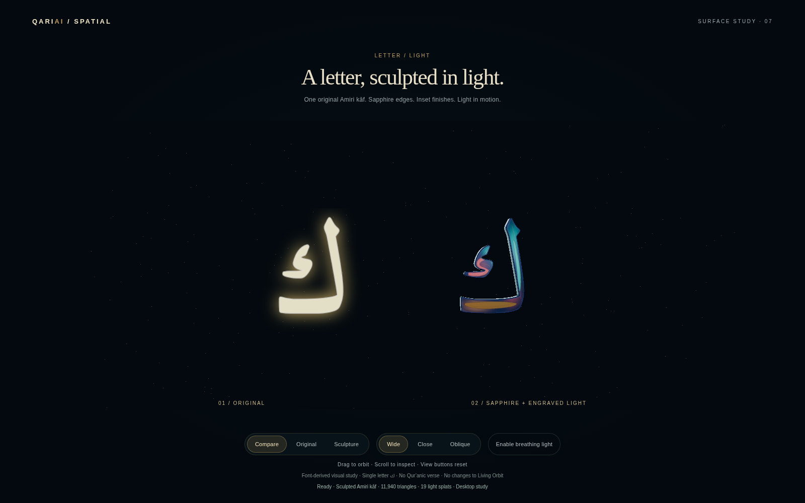
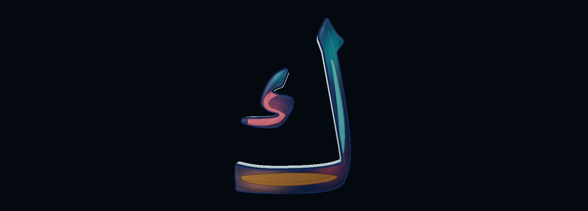

# Letter / Light — defined material regions and close inspection

Isolated draft PR #34, branch `prototype/spark-letter-study-v0.1`. Opt-in route `/spark-letter/index.html`. Living Orbit baseline remains PR #33 at `ad10ee39ee0f16262e7b3654b24bad23a34351ff`.

## Owner-directed refinement

The owner requested a few flowing inset panels, distinct satin/polished/finely engraved finishes, more visible view-dependent reflections and drag-to-orbit inspection. Surface 07 strengthens three **surface-mask pockets** within the existing strokes: a polished flowing lower sweep, a satin stem insert and a finely engraved region on the detached component. These are non-scriptural surface ornaments, not new lettering or cuts through the letter.

All pockets are gated by the original outline's interior distance. Their edges are softened in the auxiliary mask. The three regions now carry defined amber, turquoise and coral pigments over a darker sapphire field. Broad spot gradients are reduced; stronger dark-blue boundary valleys separate the regions. The lower pocket is broader and more flowing, with selective fine etching; the stem insert is more legible. The existing two maps now pack colour plus **height / roughness / metalness**. Polished, satin and engraved regions have different specular widths and metal response; the small engraved area has restrained hatching/grain. Physical clearcoat and thin-film response use the studio environment. After owner evidence showed the rear too dark, one rear reflection card was added to the baked studio environment. It is not a new visible object or per-frame scene light; environment resolution, direct lights and draw count stay unchanged. Pigment and the subtle shoulder accent are static; physical environment reflections and film response change with viewing angle. No full-face rainbow was added.

**Inset panel depth and fine engraving are bump shading, not new physical cuts.** The existing solid extrusion, inward bevel and shallow crown remain unchanged. Both Arabic components, original curves, XY silhouette, open spaces and tessellation are preserved. Spark remains a secondary light fringe.

Drag on the canvas to orbit; scroll to inspect. Arrow keys rotate, +/- zoom, Home restores the last preset. Wide and Oblique retain their previous endpoints. Close now frames the single letter at distance 4.8 instead of 6.4 (comparison mode 8.4 instead of 10), making the complete letter about one third larger without cropping. The same new Close pose is used for both original and sculpture; the browser test projects all eight bounding-box corners inside the frame. Single-pointer capture is released on up, cancel, lost capture or window blur. Orbit pitch and distance are bounded; no automatic rotation or inertia is introduced. This is desktop/touch study inspection, not a new XR interaction or any change to Living Orbit's cameras.

Earlier studies remain under [phase 1](phase1/README.md), [phase 2](phase2/README.md), [phase 3](phase3/README.md), plus the retained surface 04/05/06 native captures below. Nothing is integrated into Living Orbit or Harf.

## Genuine visual evidence

| View | Original face | Surface study |
| --- | --- | --- |
| Wide | [Original](original-wide.png) | [Sculpture](hybrid-wide.png) |
| Close | [Original](original-close.png) | [Sculpture](hybrid-close.png) |
| Oblique | [Original](original-oblique.png) | [Sculpture](hybrid-oblique.png) |


[Surface 04](surface04-native-oblique.png) → [Previous surface 05](surface05-native-oblique.png) → [Previous surface 06](surface06-native-oblique.png) → [Current surface 07, same oblique preset](hybrid-oblique.png)



All seven matched preset captures and one pointer-driven inspection capture at 1600×1000 were saved, with matching A/B camera endpoints and projection. The complete harness then reached its 180-second overall budget during the interaction chapter, so its report remains **timeout / success:false**. It was not repeatedly rerun. A separate focused inspection run covers the controls and native front/side/rear captures; see `inspection-focused-report.json` (**passed**, including native close, side and rear images). The additional native image is an actual WebGL canvas readback without HTML compositing, not a generated image or retouched artwork. SwiftShader can omit some HTML text in full-page images; direct canvas capture avoids that software-compositor artifact. No GPU draws are skipped. Timing windows precede readbacks. Sparse software-renderer samples remain unsuitable for a hardware performance claim. Breathing light is off for comparisons. Existing Wide/Close/Oblique controls and reduced-motion behavior remain; only the Close framing is intentionally changed.

[Genuine drag-to-orbit inspection](inspection-orbit.png), [side](side-native.png) and [rear](rear-native.png) show actual views produced by pointer/keyboard events. The rear is naturally reversed when seen from behind; neither geometry nor UVs are flipped to fake a front view. These are study-only camera controls, not a replacement for the application camera. The browser report records its camera and tests restoration, wheel zoom, keyboard control and pointer cancellation.

**Assessment:** the three coloured regions and dark divisions read more clearly than the preceding largely smooth gradient. Close now reveals selective etching, and rear reflection coverage makes full orbit inspection useful. Reflections still vary strongly with angle and some side/rear orientations are darker; this is not uniformly self-lit artwork. This is a font-derived study, not bespoke calligraphy or an authenticated Thuluth composition. Small reflection/bump detail can alias in software captures. Physical Quest performance and stereo remain unverified. Stop for owner visual review.

## Original Arabic contours and physical crown

- Single letter: **ك / U+0643**, original Amiri `uni0643`, font version 1.002. No verse, new letter, invented join or ligature.
- Unchanged font SHA-256: `65e3e6fe6af66bb6d24959bd537a89ea35de14083f5a2e2290c246136c2b047b`; existing OFL remains in `public/fonts/OFL-Amiri.txt`.
- `scripts/extract-spark-letter.py --check` reproduces exact original fontTools SVGPathPen commands, bounds and two contours from the TTF. Path SHA-256 remains `2c381807e055fc8a08b6e03f4e4c605e4279af6cbc26334e272763b862b8d8c4`.
- Both body and detached inner component remain separate solid meshes. There is no glowing face-image overlay on the sculpture; Original mode retains that comparison image.
- Bevels are cut inward. `crowned-cap.js` partitions existing front-cap triangles into four by midpoint subdivision. It changes only vertex Z and surface normals, never source path commands or XY coordinates. Maximum cap elevation is **0.004** study units, with analytic normals; the crown does not inflate, warp or widen the projected lettering.
- A synthetic shape with a protected hole verifies equal projected cap area, unchanged XY bounds, positive front winding, bounded real Z elevation, finite normalized normals and unchanged material groups. Actual glyph XY bounds remain within original transformed curve bounds. No raster tracing or new outline is used.
- A finer cap candidate tripped the unchanged 20,000-triangle / 2 MiB guard and was rejected before publication. Final subdivision stays within that envelope; no budget was relaxed.
- Native/vector silhouette overlap remains approximately **0.97154**, with **zero lost native stroke-core pixels** and **zero filled native gap-core pixels** outside a one-pixel AA neighbourhood at the original 256px comparison scale. Original-face comparison is independently byte-identical in the controlled browser. Different representations are not falsely claimed pixel-identical.
- Sampling-mask hashes are renderer-dependent. Secondary splat tails are not the authoritative glyph geometry. None of these font-derived checks is a qualified calligrapher approval of a new composition.

## Measured resource envelope

Physical letter: **11,940 triangles / 1,146,240 bytes (~1.093 MiB)**, unchanged from phase 3. This pass adds **zero geometry bytes, triangles, draw calls or texture bytes** relative to surfaces 04/05/06. Limits remain 20,000 triangles / 2 MiB.

Body depth is 0.20, inward bevel size 0.012, end bevel thickness 0.020 and cap crown at most 0.004. This is a desktop study scale, not a headset-scale comfort claim.

The unchanged 384×512 HDR environment and 512×512 self-shadow map remain. Two **384×576 RGBA8 surface maps** replace three 128×128 maps. Their combined raw payload is **1,769,472 bytes (1.6875 MiB)**; with mipmaps the estimate is **2.25 MiB**, an increase of **2.0625 MiB** over the prior unmipped surface maps. Bump, roughness, metalness and clearcoat roughness share one packed texture. Additional material sampling/shader work is not claimed free; no hardware performance conclusion follows from equal allocation. All map alpha values remain opaque; no discard, displacement, parallax or new contour is introduced. The floor remains absent. Secondary splat count remains small and raster-dependent (19 in the controlled run); it was 4,516 in phase 1. Runtime draw counts, texture dimensions, packed capacity and sparse timing samples are in `browser-report.json` and `resource-summary.json`. Texture sums are incomplete uncompressed estimates, not driver VRAM; software frame intervals are not Windows hardware or Quest FPS.

Spark 2.3.1 and Three 0.180.0 remain isolated in page-local licensed vendor modules. Root application dependencies still use Three 0.160.1. All existing main application sources and built JS/CSS assets remain unchanged. The opt-in assets load only on this page; no startup or performance benefit for Orbit is claimed.

## Validation

```sh
python scripts/extract-spark-letter.py --check
node scripts/check-spark-crown.cjs
node scripts/check-spark-study-scope.cjs
node scripts/check-spark-study.cjs
# Focused inspection: start Vite on 5314 first, or set STUDY_URL
node scripts/check-spark-inspection.cjs
npm run build
```

Extraction needs development-only fontTools. The browser harness uses existing Playwright/Chromium and explicit SwiftShader for reproducibility; CHROMIUM_PATH can select an installed browser. These captures do not constitute a Windows hardware run.

Auxiliary-map tests verify opaque texels, finite distance data, a protected synthetic opening, zero outside distance, all three panel finishes, roughness/metalness separation and the unchanged geometry budget. Real browser pointer/keyboard tests cover orbit, wheel zoom, Home restoration, pointer cancellation, preset restoration and side/rear views. Close-framing projection verifies no bounding-box clipping.

Existing eight recorded Qur'anic excerpts, Harf tracing/body/dot/pinch/session, ink/smoothing, integration completion/navigation, menu state and recovery checks pass. Production TypeScript/Vite build passes with its inherited chunk-size warning. Original Orbit/Harf built assets match the pinned baseline byte-for-byte.

No Living Orbit shader, light, ring, planet, camera, seven-letter interaction or phase is changed. No Harf behavior, competition footage, vector-intake contract, earlier PR, main, Android or production change. No merge or production deployment. Review this isolated finish before any integration.
