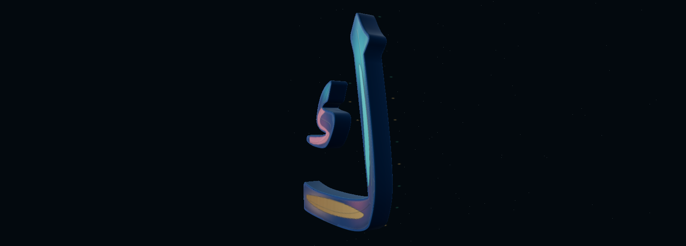

# Letter / Light — proof-to-texture feasibility study

Isolated draft PR #34, branch `prototype/spark-letter-study-v0.1`. Opt-in route `/spark-letter/index.html`. Living Orbit baseline remains PR #33 at `ad10ee39ee0f16262e7b3654b24bad23a34351ff`.

## Current — diagnosed bump attenuation, finish 13

[Map/shader diagnosis](map-audit-13/README.md) and [Finish 13 report](finish-13/README.md). The maps contain detail, but inherited bumpScale .005 attenuates the normal response. The experimental material alone tests .5 with identical maps and geometry. Use `finish=proof`, label **EXPERIMENTAL FINISH · 13**. Stop for owner review.

## Previous — channel profile and finish separation, finish 12

[Finish 12 report](finish-12/README.md): more defined symmetric auxiliary channel shoulders and clearer polished/satin/engraved roughness separation. Use `?mode=hybrid&view=close&finish=proof`; the label reads **EXPERIMENTAL FINISH · 12**. Geometry, framing, palette, lighting and default Surface 08 remain fixed. Stop for owner visual review.

## Previous — experimental satin response, finish 11

[Finish 11 changes, checks and capture limitations](finish-11/README.md). Use `?mode=hybrid&view=close&finish=proof`; the header reads **EXPERIMENTAL FINISH · 11**. This revision reduces painted channel contrast and rebalances the existing roughness/metalness maps. Geometry, framing, palette, default Surface 08 and lighting remain unchanged. Browser integrity checks pass, but both optional native captures timed out; visual improvement remains for owner review.

## Previous — proof baked for feasibility review

[Surface 10: opt-in experimental bake, genuine initial trial captures, retained/omitted detail and resource checks](bake-10/README.md). The owner approved continuation from [the exact-outline 2D design proof](proof-09/README.md). The working Surface 08 finish remains the default. Only `finish=proof` loads the experimental maps; geometry, framing, material parameters and lighting stay fixed. The calibrated candidate could not be reliably captured here and is not visually approved.

Surface 08 remains the default baseline; its earlier evidence below is **not evidence of the experimental bake**.

## Owner-directed refinement

Surface 08 is a deliberately narrow finish pass: **satin sapphire sidewalls and finer, less repetitive panel engraving**. Geometry, framing, the three existing colour regions, face material, environment, direct lights, exposure and glow are fixed.

Side/bevel material changes from `#16355c` / metalness 0.78 / roughness 0.34 / iridescence 0.22 to `#244d78` / 0.42 / 0.56 / 0.08. Lower metalness retains more diffuse sapphire colour; higher roughness spreads reflections into a quieter satin response. No emissive or extra light is added.

Seven selectively placed, unequal curved incisions replace the periodic panel hatching. They are auxiliary material details, gated to the **existing** lower and detached-component panels and glyph interiors. Fine grain remains restrained. Panel paths, colours and sample coverage are unchanged. This is bump/material engraving, not physically cut geometry, new lettering, invented joins or a new colour region. The original solid extrusion, inward bevel and crown remain unchanged.

Drag/scroll/keyboard inspection is unchanged. Wide, Close and Oblique retain surface 07's exact endpoints, including its larger non-clipping Close view. Geometry and camera code are untouched. The previously added baked rear reflection card is retained without alteration.

## Genuine visual evidence

| View | Previous surface 07 | Current surface 08 |
| --- | --- | --- |
| Close | [Previous](surface07-native-close.png) | [Current](sculpture-native-close.png) |
| Side | [Previous](surface07-side-native.png) | [Current](side-native.png) |



These are real WebGL canvas captures at the same preset/keyboard-driven poses. No fabricated images, geometry suppression or postprocessing is used. Sidewalls remain darker than the face at some angles; the change is a subtle sapphire satin response, not uniform self-illumination. The sparse engraving is intentionally quiet at wide distances. Texture/mesh aliasing remains possible. This is still a font-derived study, not bespoke or authenticated Thuluth.

**Current test limit:** the bounded 120-second focused run passed source-mask/font/path identity, both components, identical geometry bounds/buffers, unchanged camera and region coverage, texture allocation, seven incision coverage, drag, wheel zoom, Home restoration and cancellation. It saved current Close and Side captures, then reached its overall limit during the remaining rear/preset chapter. Its report remains **success:false / timeout:true**; no repeated lengthy capture run was attempted. Rear and final preset checks are not claimed newly passed. The unchanged controls have prior evidence in [surface 07's successful report](surface07-inspection-report.json).

The [previous rear capture](surface07-rear-native.png), earlier root preset/drag PNGs and `browser-report.json` are **surface 07 historical evidence**, not current finish captures. That broad harness also reached its overall time budget. Source extraction, synthetic geometry/hole checks, Arabic-content checks and production build pass separately. Hardware performance and physical Quest validation remain pending.

Earlier stages are preserved under [phase 1](phase1/README.md), [phase 2](phase2/README.md), [phase 3](phase3/README.md) and the named surface captures. Stop for owner visual review before integration.

## Original Arabic contours and physical crown

- Single letter: **ك / U+0643**, original Amiri `uni0643`, font version 1.002. No verse, new letter, invented join or ligature.
- Unchanged font SHA-256: `65e3e6fe6af66bb6d24959bd537a89ea35de14083f5a2e2290c246136c2b047b`; existing OFL remains in `public/fonts/OFL-Amiri.txt`.
- `scripts/extract-spark-letter.py --check` reproduces exact original fontTools SVGPathPen commands, bounds and two contours from the TTF. Path SHA-256 remains `2c381807e055fc8a08b6e03f4e4c605e4279af6cbc26334e272763b862b8d8c4`.
- Both body and detached inner component remain separate solid meshes. There is no glowing face-image overlay on the sculpture; Original mode retains that comparison image.
- Bevels are cut inward. `crowned-cap.js` partitions existing front-cap triangles into four by midpoint subdivision. It changes only vertex Z and surface normals, never source path commands or XY coordinates. Maximum cap elevation is **0.004** study units, with analytic normals; the crown does not inflate, warp or widen the projected lettering.
- A synthetic shape with a protected hole verifies equal projected cap area, unchanged XY bounds, positive front winding, bounded real Z elevation, finite normalized normals and unchanged material groups. Actual glyph XY bounds remain within original transformed curve bounds. No raster tracing or new outline is used.
- A finer cap candidate tripped the unchanged 20,000-triangle / 2 MiB guard and was rejected before publication. Final subdivision stays within that envelope; no budget was relaxed.
- Native/vector silhouette overlap remains approximately **0.97154**, with **zero lost native stroke-core pixels** and **zero filled native gap-core pixels** outside a one-pixel AA neighbourhood at the original 256px comparison scale. Original-face comparison is independently byte-identical in the controlled browser. Different representations are not falsely claimed pixel-identical.
- Sampling-mask hashes are renderer-dependent. Secondary splat tails are not the authoritative glyph geometry. None of these font-derived checks is a qualified calligrapher approval of a new composition.

## Measured resource envelope

Physical letter: **11,940 triangles / 1,146,240 bytes (~1.093 MiB)**, unchanged from phase 3. This pass adds **zero geometry bytes, triangles, draw calls or texture bytes** relative to surface 07. Limits remain 20,000 triangles / 2 MiB.

Body depth is 0.20, inward bevel size 0.012, end bevel thickness 0.020 and cap crown at most 0.004. This is a desktop study scale, not a headset-scale comfort claim.

The unchanged 384×512 HDR environment and 512×512 self-shadow map remain. Two **384×576 RGBA8 surface maps** replace three 128×128 maps. Their combined raw payload is **1,769,472 bytes (1.6875 MiB)**; with mipmaps the estimate is **2.25 MiB**, an increase of **2.0625 MiB** over the prior unmipped surface maps. Bump, roughness, metalness and clearcoat roughness share one packed texture. Additional material sampling/shader work is not claimed free; no hardware performance conclusion follows from equal allocation. All map alpha values remain opaque; no discard, displacement, parallax or new contour is introduced. The floor remains absent. Secondary splat count remains small and raster-dependent (19 in the controlled run); it was 4,516 in phase 1. Runtime draw counts, texture dimensions, packed capacity and sparse timing samples are in `browser-report.json` and `resource-summary.json`. Texture sums are incomplete uncompressed estimates, not driver VRAM; software frame intervals are not Windows hardware or Quest FPS.

Spark 2.3.1 and Three 0.180.0 remain isolated in page-local licensed vendor modules. Root application dependencies still use Three 0.160.1. All existing main application sources and built JS/CSS assets remain unchanged. The opt-in assets load only on this page; no startup or performance benefit for Orbit is claimed.

## Validation

```sh
python scripts/extract-spark-letter.py --check
node scripts/check-spark-crown.cjs
node scripts/check-spark-study-scope.cjs
node scripts/check-spark-study.cjs
# Focused inspection: start Vite on 5314 first, or set STUDY_URL
node scripts/check-spark-inspection.cjs
npm run build
```

Extraction needs development-only fontTools. The browser harness uses existing Playwright/Chromium and explicit SwiftShader for reproducibility; CHROMIUM_PATH can select an installed browser. These captures do not constitute a Windows hardware run.

Auxiliary-map tests verify opaque texels, finite distance data, a protected synthetic opening, zero outside distance, all three panel finishes, roughness/metalness separation and the unchanged geometry budget. The current focused run verifies unchanged source/geometry/camera/regions and orbit, zoom, Home and cancellation before its overall timeout. Prior preset/rear and no-clipping results are historical; geometry and framing remain unchanged.

Existing eight recorded Qur'anic excerpts, Harf tracing/body/dot/pinch/session, ink/smoothing, integration completion/navigation, menu state and recovery checks pass. Production TypeScript/Vite build passes with its inherited chunk-size warning. Original Orbit/Harf built assets match the pinned baseline byte-for-byte.

No Living Orbit shader, light, ring, planet, camera, seven-letter interaction or phase is changed. No Harf behavior, competition footage, vector-intake contract, earlier PR, main, Android or production change. No merge or production deployment. Review this isolated finish before any integration.
