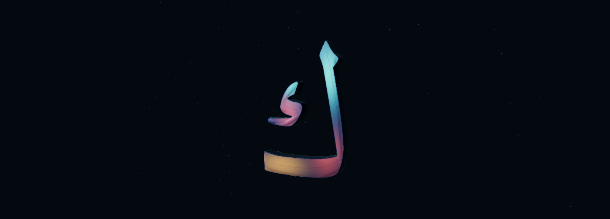

# Letter / Light — sapphire and engraved light

Isolated draft PR #34, branch `prototype/spark-letter-study-v0.1`. Opt-in route `/spark-letter/index.html`. Living Orbit baseline remains PR #33 at `ad10ee39ee0f16262e7b3654b24bad23a34351ff`.

## Owner-directed refinement

The owner requested a **dark sapphire perimeter**, localized amber/coral/turquoise highlights, fine engraved channels, subtle texture and softer face-to-wall transitions. This pass replaces the previous full-face colour sweep with deliberately placed colour fields and a dark inset border on the same floating solid letter.

`surface-design.js` derives auxiliary interior distance from the unchanged font outline. This drives the sapphire edge, a fine inset valley and restrained reflected lip. Three small, nonscriptural channel curves are confined to stroke interiors; they affect colour, bump and roughness only. They do not cut or replace the Arabic contours. Fine brushed/grain relief and physical clearcoat/iridescence respond to the existing studio lighting. Colour fields are static, reflections are view-dependent. Side/bevel normals are averaged at shared positions and meet the cap smoothly; no positions or triangle counts change in this pass.

**The new fine engraving is bump shading, not physically cut channels.** The underlying solid extrusion and shallow crown remain real geometry from phase 3. The exact font path, detached internal component, silhouette and open spaces are retained. Spark remains a sparse secondary light fringe.

Prior iterations are preserved: [phase 1](phase1/README.md) Spark shell, [phase 2](phase2/README.md) gold/bronze, and [phase 3](phase3/README.md) floating iridescent sculpture at `21cb127`. Nothing is integrated into Living Orbit or Harf.

## Genuine visual evidence

| View | Original face | Surface study |
| --- | --- | --- |
| Wide | [Original](original-wide.png) | [Paired comparison](compare-wide.png) |
| Close | Current capture unavailable; [previous unchanged face](phase3/original-close.png) | [Sculpture](hybrid-close.png) |
| Oblique | [Original](original-oblique.png) | [Sculpture](hybrid-oblique.png) |




Five of seven real 1600×1000 full-page captures succeeded with matching A/B camera endpoints and projection. Standalone sculpture-wide and original-close screenshots hit their bounded 8-second timeout; stale prior images were removed. The paired wide image contains the current sculpture. All seven camera/projection and interaction checks passed; no repeated lengthy capture retries were attempted. The additional native image is an actual WebGL canvas readback without HTML compositing, not a generated image or retouched artwork. SwiftShader can omit some HTML text in full-page images; direct canvas capture avoids that software-compositor artifact. No GPU draws are skipped. Timing windows precede readbacks, but concurrent build work and software-renderer load make these sparse samples unsuitable for a before/after performance claim. Breathing light is off for comparisons. Existing Wide/Close/Oblique controls and reduced-motion behavior remain.

**Assessment:** the dark edge separates the silhouette from the coloured face, while the inset channels and smoother shoulders give more intentional surface structure. Amber is concentrated along the lower sweep, coral at its turn and the internal component, and turquoise on the upper stem. Small reflective details can alias in close software captures. This remains a font-derived study, not bespoke interwoven calligraphy or authenticated Thuluth. Physical Quest performance and stereo remain unverified. Stop for owner visual review.

## Original Arabic contours and physical crown

- Single letter: **ك / U+0643**, original Amiri `uni0643`, font version 1.002. No verse, new letter, invented join or ligature.
- Unchanged font SHA-256: `65e3e6fe6af66bb6d24959bd537a89ea35de14083f5a2e2290c246136c2b047b`; existing OFL remains in `public/fonts/OFL-Amiri.txt`.
- `scripts/extract-spark-letter.py --check` reproduces exact original fontTools SVGPathPen commands, bounds and two contours from the TTF. Path SHA-256 remains `2c381807e055fc8a08b6e03f4e4c605e4279af6cbc26334e272763b862b8d8c4`.
- Both body and detached inner component remain separate solid meshes. There is no glowing face-image overlay on the sculpture; Original mode retains that comparison image.
- Bevels are cut inward. `crowned-cap.js` partitions existing front-cap triangles into four by midpoint subdivision. It changes only vertex Z and surface normals, never source path commands or XY coordinates. Maximum cap elevation is **0.004** study units, with analytic normals; the crown does not inflate, warp or widen the projected lettering.
- A synthetic shape with a protected hole verifies equal projected cap area, unchanged XY bounds, positive front winding, bounded real Z elevation, finite normalized normals and unchanged material groups. Actual glyph XY bounds remain within original transformed curve bounds. No raster tracing or new outline is used.
- A finer cap candidate tripped the unchanged 20,000-triangle / 2 MiB guard and was rejected before publication. Final subdivision stays within that envelope; no budget was relaxed.
- Native/vector silhouette overlap remains approximately **0.97154**, with **zero lost native stroke-core pixels** and **zero filled native gap-core pixels** outside a one-pixel AA neighbourhood at the original 256px comparison scale. Original-face comparison is independently byte-identical in the controlled browser. Different representations are not falsely claimed pixel-identical.
- Sampling-mask hashes are renderer-dependent. Secondary splat tails are not the authoritative glyph geometry. None of these font-derived checks is a qualified calligrapher approval of a new composition.

## Measured resource envelope

Physical letter: **11,940 triangles / 1,146,240 bytes (~1.093 MiB)**, unchanged from phase 3. This pass adds **zero geometry bytes, triangles or draw calls**. Limits remain 20,000 triangles / 2 MiB.

Body depth is 0.20, inward bevel size 0.012, end bevel thickness 0.020 and cap crown at most 0.004. This is a desktop study scale, not a headset-scale comfort claim.

The unchanged 384×512 HDR environment and 512×512 self-shadow map remain. Two **384×576 RGBA8 surface maps** replace three 128×128 maps. Their combined raw payload is **1,769,472 bytes (1.6875 MiB)**; with mipmaps the estimate is **2.25 MiB**, an increase of **2.0625 MiB** over the prior unmipped surface maps. Bump and roughness share one texture. All map alpha values remain opaque; no discard, displacement, parallax or new contour is introduced. The floor remains absent. Secondary splat count remains small and raster-dependent (19 in the controlled run); it was 4,516 in phase 1. Runtime draw counts, texture dimensions, packed capacity and sparse timing samples are in `browser-report.json` and `resource-summary.json`. Texture sums are incomplete uncompressed estimates, not driver VRAM; software frame intervals are not Windows hardware or Quest FPS.

Spark 2.3.1 and Three 0.180.0 remain isolated in page-local licensed vendor modules. Root application dependencies still use Three 0.160.1. All existing main application sources and built JS/CSS assets remain unchanged. The opt-in assets load only on this page; no startup or performance benefit for Orbit is claimed.

## Validation

```sh
python scripts/extract-spark-letter.py --check
node scripts/check-spark-crown.cjs
node scripts/check-spark-study-scope.cjs
node scripts/check-spark-study.cjs
npm run build
```

Extraction needs development-only fontTools. The browser harness uses existing Playwright/Chromium and explicit SwiftShader for reproducibility; CHROMIUM_PATH can select an installed browser. These captures do not constitute a Windows hardware run.

Auxiliary-map tests verify opaque texels, finite distance data, a protected synthetic opening, zero outside distance, channel/perimeter presence and the unchanged geometry budget.

Existing eight recorded Qur'anic excerpts, Harf tracing/body/dot/pinch/session, ink/smoothing, integration completion/navigation, menu state and recovery checks pass. Production TypeScript/Vite build passes with its inherited chunk-size warning. Original Orbit/Harf built assets match the pinned baseline byte-for-byte.

No Living Orbit shader, light, ring, planet, camera, seven-letter interaction or phase is changed. No Harf behavior, competition footage, vector-intake contract, earlier PR, main, Android or production change. No merge or production deployment. Review this isolated finish before any integration.
