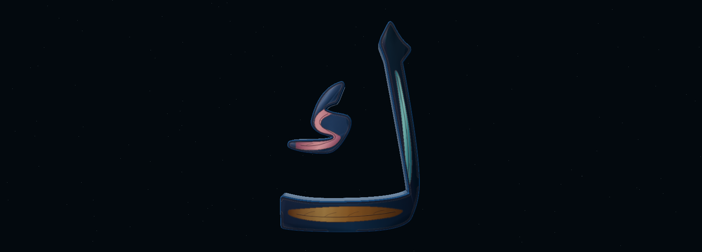

# Surface 10 — bounded bake of the approved 2D proof

The owner approved continuation from [proof 09](../proof-09/README.md). **The working Surface 08 finish remains the default.** Use `?mode=hybrid&view=close&finish=proof` for the experimental candidate; invalid or duplicate finish values use the original finish. This is the first rendering feasibility bake, not a claim that the illustrative SVG and metallic renderer produce identical appearance.

## What is baked

- Exact proof spine paths in all three existing panels.
- Ten selected branch paths, with original path centres preserved.
- Decorative branch width changes from 1.2 to 1.6 font units: about 1.12 texels horizontally at the fixed 384-wide map. Main courses remain 2.5 units, about 1.75 texels.
- Eight finest accents and seven secondary branches are omitted as **surface ornament**, not Arabic wording or glyph strokes. The sub-texel 0.55-unit highlight is not baked as a separate vector line; the existing bump/shoulder response supplies a restrained edge.
- Localized tonal gradients and a quiet sapphire field follow the proof's three materials. They are static pigment variation; the unchanged physical material supplies view-dependent reflections.
- The first direct palette transfer made the sapphire field too dark under the existing metallic material. The base pigment uses a 1.7 linear-reflectance calibration. Lights, exposure, tone mapping, physical materials and wall finish remain unchanged; no emissive/glow is introduced.
- Engraving coverage uses its actual canvas alpha and corresponding panel ownership. Fine ornament does not spill into another panel, the background or open spaces.

`engraving-design.js` records the approved SVG hash, exact retained ornament centres, widths and omissions. [Source audit](source-audit.json) verifies proof provenance and unchanged sculpture, glyph, camera and lighting files.

## Actual visual evidence and unresolved capture limit

| Capture | Status |
| --- | --- |
| [Surface 08 before](before-close.png) | Genuine reference Close image |
| [Initial uncalibrated trial, Close](trial-uncalibrated-close.png) | Genuine bake before the base lightness calibration |
| [Initial uncalibrated trial, Oblique](trial-uncalibrated-oblique.png) | Genuine additional trial view |
| Calibrated 1.7 candidate | **No reliable capture obtained here** |



The initial bake retained the composed engraving but made the field too dark. The calibrated bake passed glyph/mask/region/resource assertions and same-browser original-face byte comparison, then its 90-second run hit its capture/overall budget during shared software-renderer/build load. A separate short native-capture attempt reached its readiness timeout. Both failure reports remain unchanged: [bake checks and timeout](report.json), [capture supplement and readiness timeout](capture-supplement.json). No further lengthy capture retries were made.

The revised candidate is therefore **experimental and visually unverified**, and is not the default finish. The direct proof link is for owner review on a hardware-accelerated browser. The old/default map factory is preserved byte-for-byte. The proof factory loads only for the single exact `finish=proof` value; geometry, materials, lights, cameras and interaction behavior are shared. A small header label identifies the experimental bake. No new application panel or scene is added.

Retained details can soften through mip filtering. The finest proof hairlines are not reproduced. This is a font-derived, texture-relief study, not physical incisions, bespoke calligraphy, a trained Gaussian asset or a claim of matching the reference's artistic richness. Calibrated native captures and owner visual approval remain outstanding.

## Fixed resources and integrity

Each finish allocates only its selected pair of 384×576 RGBA8 maps: 1,769,472 raw bytes, approximately 2.25 MiB with mipmaps. No new GPU map, draw, geometry or buffer is added. The letter remains 11,940 triangles / 1,146,240 vertex-buffer bytes. Original font/path, two components, masks, bounds, panel coverage, UV construction, camera framing and all material/lighting parameters and inspection behavior are unchanged.

The [bounded bake report](report.json) records actual initialization/map-generation elapsed time, native-source-face comparison, resource estimates and ordinary frame samples before readbacks. Those sparse software timings are not controlled before/after performance, Windows hardware FPS, Quest FPS or driver VRAM measurements. The added small JS data module and auxiliary canvas work have startup cost; equal GPU allocation does not mean zero CPU work.

Reproduce with Vite serving the repository on port 5314 (or set `STUDY_URL`):

```sh
node scripts/check-spark-bake.cjs
python scripts/extract-spark-letter.py --check
node scripts/check-spark-crown.cjs
node scripts/check-calligraphy-content.mjs
npm run build
```

No Living Orbit, Harf, competition film, Android, main or production changes. No merge or production deployment. Stop for visual review.
