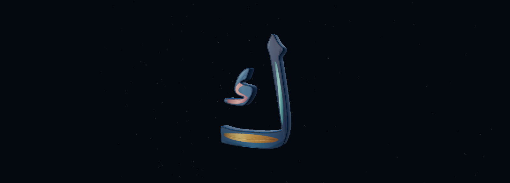

# Experimental finish 13 — correct the attenuated bump response

Baseline: finish 12, `94fc447cea0646f7c52deed74a6359f33caf80fe`. [Map/shader diagnosis](../map-audit-13/README.md) found real channel detail in the baked maps, correctly connected to Three.js. However, the inherited face `bumpScale: .005` made its normal perturbation extremely small.

## Minimal correction

For the explicit single `finish=proof` selection only, use **bumpScale .5**. Default Surface 08 keeps **.005**. This changes the response of the exact same height map, not physical extrusion or geometry. The shader, palette, roughness, metalness, all texture bytes, sidewalls, lights, camera, framing and ornament paths remain unchanged from finish 12. No additional map, geometry, glow, colour region or panel.

The material-scale report reads the actual `gold.bumpScale`, and the browser test asserts it alongside the existing glyph/mask/coverage/resource checks. [Source audit](source-audit.json) verifies unchanged map/geometry/camera/lighting sources and precisely restricts the material change.

## Preview and visual evidence

https://qariai-spatial-git-prototype-spark-lett-805d90-qariais-projects.vercel.app/spark-letter/index.html?mode=hybrid&view=close&finish=proof

Look for **EXPERIMENTAL FINISH · 13**. Compare Close/Oblique and drag slowly to inspect highlight changes. The default page still shows Surface 08.

[Before Close](../finish-12/close.png) · [Before Oblique](../finish-12/oblique.png). Candidate capture results are recorded in [browser report](report.json); only successfully captured native images count as new visual evidence. This is still a font-derived material study, not bespoke calligraphy or a trained Gaussian asset.

## Actual matched rendering result

[After Close](close.png) · [After Oblique](oblique.png). Both native canvas captures succeeded in the bounded run. [Comparison](comparison.json) confirms identical camera position, orientation, projection and image dimensions against the saved finish 12 captures, under the same Chromium/SwiftShader settings.

| View | Before: .005 | After: .5 |
| --- | --- | --- |
| Close | [Finish 12](../finish-12/close.png) | [Finish 13](close.png) |
| Oblique | [Finish 12](../finish-12/oblique.png) | [Finish 13](oblique.png) |

The amber spine and branches now show visible paired light/shadow edges, especially in Oblique, rather than depending on a painted dark line. The effect remains restrained and does not reproduce the reference butterfly's authored richness. Narrower turquoise/coral ornament is less apparent at this framing; no resolution increase or artwork change was introduced. Geometry, silhouette, component spacing and framing are unchanged. Owner hardware-browser visual approval remains outstanding.

## Fixed costs and remaining limitations

11,940 letter triangles, 1,146,240 geometry-buffer bytes; two 384×576 RGBA8 maps, 1,769,472 raw bytes / estimated 2,359,296 with mipmaps. No extra meshes, draws, GPU textures, shader variants or map-bake work. One uniform value changes in the existing experimental material. Renderer final-pass draw counters are not whole-scene totals.

The approximately 0.05° versus 4.8° p95 estimate is an analytical source-map comparison, not a framebuffer measurement, physical depth measurement or hardware performance claim. Mip filtering still limits narrow branches. No change to the Arabic silhouette or detached component is permitted. Owner visual approval and physical Quest validation remain outstanding.

See [validation](validation.json) for build/integrity results and [browser report](report.json) for genuine rendering checks. No full Harf/XR regression rerun is claimed for this isolated material uniform; their source and baseline built assets are checked unchanged.

No Living Orbit, Harf, competition footage, Android, main or production changes. No merge or production deployment. Stop for visual review.
