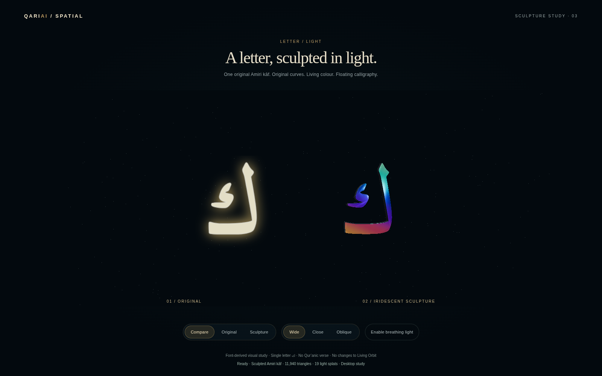
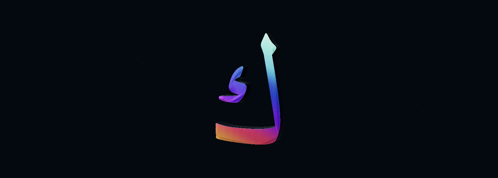

# Letter / Light — floating iridescent sculpture

Isolated draft PR #34, branch `prototype/spark-letter-study-v0.1`. Opt-in route `/spark-letter/index.html`. Living Orbit baseline remains PR #33 at `ad10ee39ee0f16262e7b3654b24bad23a34351ff`.

## Owner-directed refinement

After reviewing the solid gold/bronze study, the owner selected **vivid iridescent colours**, using Spark's butterfly as a quality/presentation reference. The current treatment has teal, sapphire, violet, coral and amber on a lighter floating letter. It removes the floor and its cast shadow, reduces body depth from 0.34 to 0.20 study units, softens the inward shoulders and adds a very shallow physical cap crown. Spark remains a sparse secondary light fringe, not the letter's solid representation.

The finish combines a smooth procedural pigment map with Three's physical thin-film iridescence, clearcoat and studio reflections. The pigment distribution itself is static; film/reflection appearance depends on view and lighting. It is not a trained Gaussian asset, butterfly reconstruction, generated calligraphic image or claim that the renderer alone supplies sculptural quality.

Prior iterations remain available for comparison: [phase 1](../phase1/README.md), the original Spark shell at `0ee06b3`; [phase 2](../phase2/README.md), the gold/bronze solid at `01e5ef5`. Nothing has been integrated into Orbit or Harf.

## Genuine visual evidence

| View | Original face | Iridescent sculpture |
| --- | --- | --- |
| Wide | [Original](original-wide.png) | [Sculpture](hybrid-wide.png) |
| Close | [Original](original-close.png) | [Sculpture](hybrid-close.png) |
| Oblique | [Original](original-oblique.png) | [Sculpture](hybrid-oblique.png) |




Seven real 1600×1000 full-page captures use matching A/B camera endpoints and projection. The additional native image is an actual WebGL canvas readback without HTML compositing, not a generated image or retouched artwork. SwiftShader can omit some HTML text in full-page images; direct canvas capture avoids that software-compositor artifact. No GPU draws are skipped. Timing windows precede readbacks. Breathing light is off for comparisons. Existing Wide/Close/Oblique controls and reduced-motion behavior remain.

**Assessment:** the floor-free presentation, thinner walls, smoother face and vivid colour move closer to the reference's lighter appearance. The result remains a font-derived kāf sculpture; it is not yet a bespoke interwoven calligraphic artwork or an authenticated Thuluth composition. Some close reflection/mesh aliasing remains possible, and physical Quest stereo/comfort/performance is unverified. Stop for owner visual review before expanding or integrating.

## Original Arabic contours and physical crown

- Single letter: **ك / U+0643**, original Amiri `uni0643`, font version 1.002. No verse, new letter, invented join or ligature.
- Unchanged font SHA-256: `65e3e6fe6af66bb6d24959bd537a89ea35de14083f5a2e2290c246136c2b047b`; existing OFL remains in `public/fonts/OFL-Amiri.txt`.
- `scripts/extract-spark-letter.py --check` reproduces exact original fontTools SVGPathPen commands, bounds and two contours from the TTF. Path SHA-256 remains `2c381807e055fc8a08b6e03f4e4c605e4279af6cbc26334e272763b862b8d8c4`.
- Both body and detached inner component remain separate solid meshes. There is no glowing face-image overlay on the sculpture; Original mode retains that comparison image.
- Bevels are cut inward. `crowned-cap.js` partitions existing front-cap triangles into four by midpoint subdivision. It changes only vertex Z and surface normals, never source path commands or XY coordinates. Maximum cap elevation is **0.004** study units, with analytic normals; the crown does not inflate, warp or widen the projected lettering.
- A synthetic shape with a protected hole verifies equal projected cap area, unchanged XY bounds, positive front winding, bounded real Z elevation, finite normalized normals and unchanged material groups. Actual glyph XY bounds remain within original transformed curve bounds. No raster tracing or new outline is used.
- A finer cap candidate tripped the unchanged 20,000-triangle / 2 MiB guard and was rejected before publication. Final subdivision stays within that envelope; no budget was relaxed.
- Native/vector silhouette overlap remains approximately **0.97154**, with **zero lost native stroke-core pixels** and **zero filled native gap-core pixels** outside a one-pixel AA neighbourhood at the original 256px comparison scale. Original-face comparison is independently byte-identical in the controlled browser. Different representations are not falsely claimed pixel-identical.
- Sampling-mask hashes are renderer-dependent. Secondary splat tails are not the authoritative glyph geometry. None of these font-derived checks is a qualified calligrapher approval of a new composition.

## Measured resource envelope

Final physical letter: **11,940 triangles / 1,146,240 bytes (~1.093 MiB)** of stored vertex arrays. Phase 2 was 8,312 / 797,952: this refinement adds 3,628 triangles and 348,288 bytes, approximately 43.6%. Limits remain 20,000 triangles / 2 MiB.

Body depth is 0.20, inward bevel size 0.012, end bevel thickness 0.020 and cap crown at most 0.004. This is a desktop study scale, not a headset-scale comfort claim.

A bounded 384×512 HDR environment, 512×512 self-shadow map and three 128×128 surface maps are explicit costs. The floor geometry/draw is removed. Secondary splat count remains small and raster-dependent (19 in the controlled run); it was 4,516 in phase 1. Runtime draw counts, texture dimensions, packed capacity and sparse timing samples are in `browser-report.json` and `resource-summary.json`. Texture sums are incomplete uncompressed estimates, not driver VRAM; software frame intervals are not Windows hardware or Quest FPS.

Spark 2.3.1 and Three 0.180.0 remain isolated in page-local licensed vendor modules. Root application dependencies still use Three 0.160.1. All existing main application sources and built JS/CSS assets remain unchanged. The opt-in assets load only on this page; no startup or performance benefit for Orbit is claimed.

## Validation

```sh
python scripts/extract-spark-letter.py --check
node scripts/check-spark-crown.cjs
node scripts/check-spark-study-scope.cjs
node scripts/check-spark-study.cjs
npm run build
```

Extraction needs development-only fontTools. The browser harness uses existing Playwright/Chromium and explicit SwiftShader for reproducibility; CHROMIUM_PATH can select an installed browser. These captures do not constitute a Windows hardware run.

Existing eight recorded Qur'anic excerpts, Harf tracing/body/dot/pinch/session, ink/smoothing, integration completion/navigation, menu state and recovery checks pass. Production TypeScript/Vite build passes with its inherited chunk-size warning. Original Orbit/Harf built assets match the pinned baseline byte-for-byte.

No Living Orbit shader, light, ring, planet, camera, seven-letter interaction or phase is changed. No Harf behavior, competition footage, vector-intake contract, earlier PR, main, Android or production change. No merge or production deployment. Review this isolated finish before any integration.
